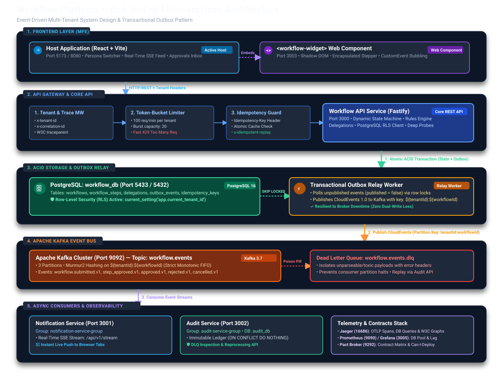
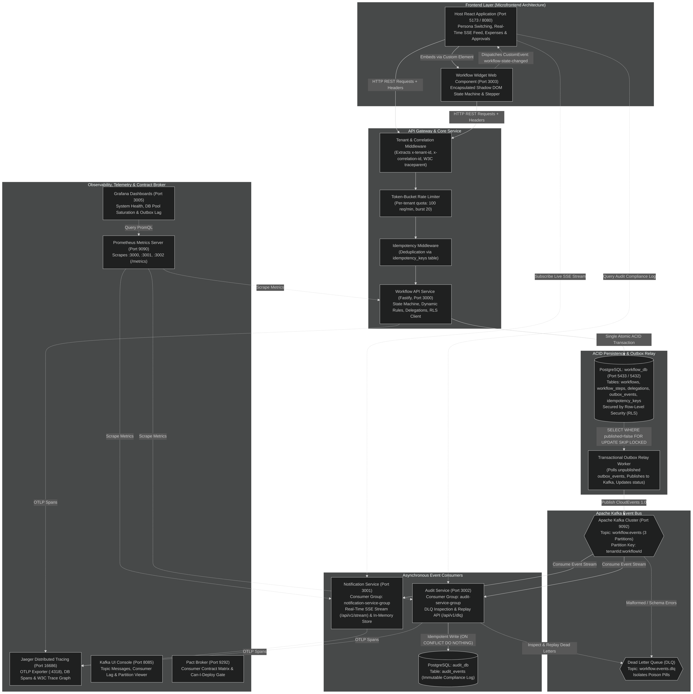
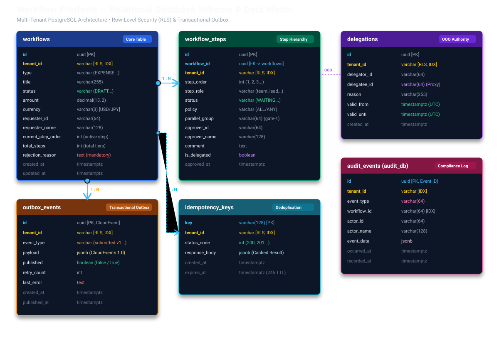
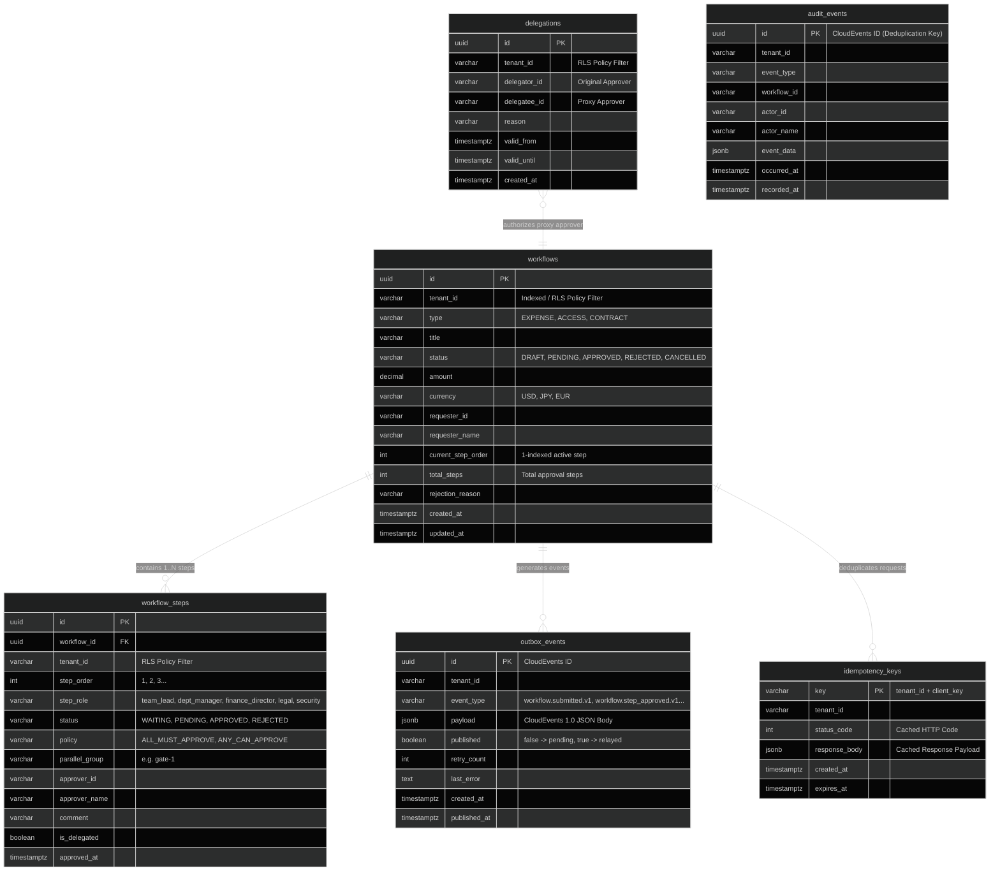
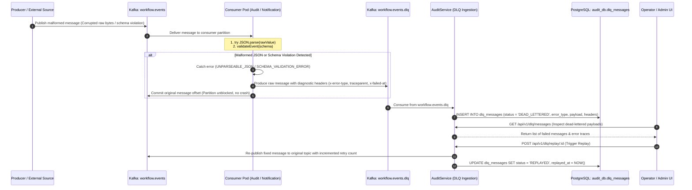

# Workflow Platform — Master Development & Quality Engineering Guide

> **The Unified Technical Reference & Interview Preparation Handbook**
> 
> This document is the **single, definitive, comprehensive reference** combining the **Software Architecture & Microservices Implementation** with the **8-Layer Quality Engineering & Testing Strategy**.
>
> Designed for deep revision, technical architecture reviews, and senior engineering interview preparation without needing to jump between disparate READMEs.

---

## 📋 Table of Contents

1. [System Architecture & Core Principles](#system-architecture-core-principles)
   - [High-Level Microservices Topology](#high-level-microservices-topology)
   - [Core Design Invariants & Tenets](#core-design-invariants-tenets)
   - [Database Schema & Data Relationships](#database-schema-data-relationships)
2. [Feature-by-Feature Deep Dive (Dev Architecture + QA Validation Matrix)](#feature-by-feature-deep-dive)
   - [Feature 1: Dynamic Multi-Step Workflow State Machine](#feature-1-dynamic-multi-step-workflow-state-machine)
   - [Feature 2: Out-of-Office Delegations & Proxy Approvals](#feature-2-out-of-office-delegations-proxy-approvals)
   - [Feature 3: Configurable Workflow Rules & Parallel Approvals (Quorums)](#feature-3-configurable-workflow-rules-parallel-approvals-quorums)
   - [Feature 4: Transactional Outbox Pattern & Broker Outage Resilience](#feature-4-transactional-outbox-pattern-broker-outage-resilience)
   - [Feature 5: Kafka Dead Letter Queue (DLQ) & Poison Pill Isolation](#feature-5-kafka-dead-letter-queue-dlq-poison-pill-isolation)
   - [Feature 6: Real-Time Live Sync via Server-Sent Events (SSE)](#feature-6-real-time-live-sync-via-server-sent-events-sse)
   - [Feature 7: PostgreSQL Row-Level Security (RLS) & DB Hardening](#feature-7-postgresql-row-level-security-rls-db-hardening)
   - [Feature 8: Multi-Tenant Rate Limiting (Token Bucket) & Noisy-Neighbor Throttling](#feature-8-multi-tenant-rate-limiting-token-bucket-noisy-neighbor-throttling)
   - [Feature 9: Microfrontend Architecture (React Host + Web Component Widget)](#feature-9-microfrontend-architecture-react-host-web-component-widget)
   - [Feature 10: End-to-End Distributed Tracing (W3C Context & DB Spans)](#feature-10-end-to-end-distributed-tracing-w3c-context-db-spans)
3. [The 8-Layer Testing Pyramid: Mechanics & File Map](#the-8-layer-testing-pyramid-mechanics-file-map)
   - [Testing Pyramid Topology](#testing-pyramid-topology)
   - [Layer 0: Static Analysis & Type Safety](#layer-0-static-analysis-type-safety)
   - [Layer 1: Unit Testing (State Machine, Fake Timers, Rate Limiter)](#layer-1-unit-testing)
   - [Layer 2: Consumer-Driven Contract Testing (HTTP Pact)](#layer-2-consumer-driven-contract-testing-http-pact)
   - [Layer 3: Event-Driven Kafka Contract Testing (MessagePact)](#layer-3-event-driven-kafka-contract-testing-messagepact)
   - [Layer 4: Service Integration Testing (Testcontainers & Outbox Loop)](#layer-4-service-integration-testing)
   - [Layer 5: End-to-End Automated Testing (Playwright & a11y)](#layer-5-end-to-end-automated-testing-playwright-a11y)
   - [Layer 6: Performance & Resilience Load Testing (k6)](#layer-6-performance-resilience-load-testing-k6)
   - [Layer 7: Security & Tenant Isolation Testing](#layer-7-security-tenant-isolation-testing)
4. [Senior Engineering Interview Technical Defense Guide](#senior-engineering-interview-technical-defense-guide)
   - [Q1: How did you solve the dual-write problem between PostgreSQL and Kafka?](#q1-how-did-you-solve-the-dual-write-problem-between-postgresql-and-kafka)
   - [Q2: How do you guarantee FIFO ordering in Kafka when scaling consumers across multiple partitions?](#q2-how-do-you-guarantee-fifo-ordering-in-kafka-when-scaling-consumers-across-multiple-partitions)
   - [Q3: Why Consumer-Driven Contract Testing (Pact) over end-to-end integration environments in CI?](#q3-why-consumer-driven-contract-testing-pact-over-end-to-end-integration-environments-in-ci)
   - [Q4: How does PostgreSQL Row-Level Security (RLS) protect multi-tenant data if an engineer omits WHERE tenant_id?](#q4-how-does-postgresql-row-level-security-rls-protect-multi-tenant-data-if-an-engineer-omits-where-tenant_id)
   - [Q5: How does the system handle poison pill messages in Kafka without blocking the topic partition?](#q5-how-does-the-system-handle-poison-pill-messages-in-kafka-without-blocking-the-topic-partition)
   - [Q6: How do you prevent duplicate approvals or financial double-charges on client network retries?](#q6-how-do-you-prevent-duplicate-approvals-or-financial-double-charges-on-client-network-retries)
   - [Q7: How do you test 48-hour time-dependent SLA escalations deterministically in milliseconds?](#q7-how-do-you-test-48-hour-time-dependent-sla-escalations-deterministically-in-milliseconds)
   - [Q8: How do the React Host App and Workflow Web Component communicate across isolation boundaries?](#q8-how-do-the-react-host-app-and-workflow-web-component-communicate-across-isolation-boundaries)
   - [Q9: How do you isolate noisy neighbors from exhausting backend API resources in a multi-tenant cloud?](#q9-how-do-you-isolate-noisy-neighbors-from-exhausting-backend-api-resources-in-a-multi-tenant-cloud)
   - [Q10: How does distributed tracing propagate across HTTP API, Kafka records, and asynchronous consumers?](#q10-how-does-distributed-tracing-propagate-across-http-api-kafka-records-and-asynchronous-consumers)
   - [Q11: What happens during a complete database pool exhaustion or leak, and how is it tested?](#q11-what-happens-during-a-complete-database-pool-exhaustion-or-leak-and-how-is-it-tested)
   - [Q12: How do you ensure zero-downtime rolling deployments on Kubernetes for event-driven microservices?](#q12-how-do-you-ensure-zero-downtime-rolling-deployments-on-kubernetes-for-event-driven-microservices)
   - [Q13: Why validate Schema Compatibility on both Producer and Consumer sides in event-driven systems?](#q13-why-validate-schema-compatibility-on-both-producer-and-consumer-sides-in-event-driven-systems)

---

## <a id="system-architecture-core-principles"></a>1. System Architecture & Core Principles

### <a id="high-level-microservices-topology"></a>High-Level Microservices Topology

The platform is designed as an **event-driven, multi-tenant microservices ecosystem**. It decouples synchronous HTTP requests (Fastify) from asynchronous event consumers (Notification and Audit services) via **Apache Kafka**, using a **Transactional Outbox** pattern guaranteeing zero data loss.

#### 🖼️ Visual Architecture Diagram (High-Resolution Vector)



> [!TIP]
> **View Full-Size Diagram**: You can open the high-resolution vector SVG directly at [`docs/assets/architecture-topology.svg`](./assets/architecture-topology.svg) to zoom in and inspect all components, ports, and data-flow pathways.

---

#### 🗺️ Structural Component & Data-Flow Map

```
┌────────────────────────────────────────────────────────────────────────────────────────────────────────┐
│ 1. FRONTEND LAYER (Microfrontend Architecture)                                                         │
│   ┌──────────────────────────────────────────────┐        ┌──────────────────────────────────────────┐ │
│   │  Host React App (Port 5173 / 8080)           │◄───────┤  <workflow-widget> Web Component (3003)  │ │
│   │  - Persona Switching & Tenant Context        │        │  - Encapsulated Shadow DOM Stepper       │ │
│   │  - Real-Time Live SSE Feed Listener          │        │  - CustomEvent('workflow-state-changed') │ │
│   └──────────────────────┬───────────────────────┘        └──────────────────────────────────────────┘ │
└──────────────────────────┼─────────────────────────────────────────────────────────────────────────────┘
                           │ HTTP REST Requests + Headers (x-tenant-id, x-correlation-id, traceparent)
                           ▼
┌────────────────────────────────────────────────────────────────────────────────────────────────────────┐
│ 2. API GATEWAY & CORE WORKFLOW SERVICE                                                                 │
│   ┌───────────────────────┐    ┌───────────────────────────┐    ┌────────────────────────────────────┐ │
│   │ 1. Tenant & Trace MW  ├───►│ 2. Token-Bucket Limiter   ├───►│ 3. Idempotency Guard (DB Cache)    │ │
│   │ (Tenant & Trace Ingest│    │ (100 req/min, burst: 20)  │    │ (Prevents Double Transitions)      │ │
│   └───────────────────────┘    └───────────────────────────┘    └─────────────────┬──────────────────┘ │
│                                                                                   │                    │
│                                                                                   ▼                    │
│   ┌──────────────────────────────────────────────────────────────────────────────────────────────────┐ │
│   │  Workflow API Service (Fastify REST Gateway, Port 3000)                                          │ │
│   │  - Multi-Step Dynamic State Machine Engine & Configurable Tenant Rules                           │ │
│   │  - Out-of-Office Delegations Evaluator & PostgreSQL RLS Context Injector                         │ │
│   │  - Deep Health Probes (/health/live, /health/ready)                                              │ │
│   └──────────────────────────────────────────────┬───────────────────────────────────────────────────┘ │
└──────────────────────────────────────────────────┼─────────────────────────────────────────────────────┘
                                                   │ Atomic PostgreSQL ACID Transaction (State + Outbox)
                                                   ▼
┌────────────────────────────────────────────────────────────────────────────────────────────────────────┐
│ 3. ACID PERSISTENCE & TRANSACTIONAL OUTBOX RELAY                                                       │
│   ┌──────────────────────────────────────────────┐        ┌──────────────────────────────────────────┐ │
│   │  PostgreSQL Database (workflow_db, Port 5433)│───────►│  Transactional Outbox Relay Worker       │ │
│   │  - workflows, workflow_steps, delegations    │ (SKIP  │  - Polls unpublished outbox_events rows  │ │
│   │  - outbox_events, idempotency_keys           │ LOCKED)│  - Publishes CloudEvents 1.0 to Kafka    │ │
│   │  - 🛡️ PostgreSQL Row-Level Security (RLS)    │        │  - Zero message loss during Kafka outage │ │
│   └──────────────────────────────────────────────┘        └───────────────────┬──────────────────────┘ │
└───────────────────────────────────────────────────────────────────────────────┼────────────────────────┘
                                                                                │ Publish CloudEvents
                                                                                ▼ (Key: tenantId:workflowId)
┌────────────────────────────────────────────────────────────────────────────────────────────────────────┐
│ 4. APACHE KAFKA EVENT BUS                                                                              │
│   ┌──────────────────────────────────────────────┐        ┌──────────────────────────────────────────┐ │
│   │  Main Topic: workflow.events (3 Partitions)  ├───────►│  Dead Letter Queue: workflow.events.dlq  │ │
│   │  - Murmur2 Key Partitioning: ${tenantId}:${wf} (Toxic  │  - Isolates malformed / poison pills     │ │
│   │  - Monotonic Strict FIFO Order Guarantee     │ Pill)  │  - Prevents consumer partition freezes   │ │
│   └──────────────────────┬───────────────────────┘        └──────────────────────────────────────────┘ │
└──────────────────────────┼─────────────────────────────────────────────────────────────────────────────┘
                           │ Consume Event Streams (notification-service-group & audit-service-group)
                           ▼
┌────────────────────────────────────────────────────────────────────────────────────────────────────────┐
│ 5. ASYNCHRONOUS CONSUMERS & OBSERVABILITY STACK                                                        │
│   ┌──────────────────────────────────────────────┐        ┌──────────────────────────────────────────┐ │
│   │  Notification Service (Fastify, Port 3001)   │        │  Audit Service (Fastify, Port 3002)      │ │
│   │  - Consumer Group: notification-service-group│        │  - Consumer Group: audit-service-group   │ │
│   │  - Real-Time Live SSE Stream: /api/v1/stream │        │  - Immutable Ledger: audit_db (ON CONFL) │ │
│   │  - Zero-Polling Browser Push Broadcasting    │        │  - DLQ Inspection & Replay REST API      │ │
│   └──────────────────────────────────────────────┘        └──────────────────────────────────────────┘ │
│   ┌──────────────────────────────────────────────────────────────────────────────────────────────────┐ │
│   │  Telemetry, Monitoring & Contract Infrastructure                                                 │ │
│   │  - Jaeger (16686): OpenTelemetry OTLP Spans, DB Query Waterfall & W3C Trace Graph                │ │
│   │  - Prometheus (9090) & Grafana (3005): Connection Pool Saturation, Outbox Lag & HTTP Rates       │ │
│   │  - Pact Broker (9292): Consumer-Driven Contract Verification Matrix & Can-I-Deploy Gate Check   │ │
│   └──────────────────────────────────────────────────────────────────────────────────────────────────┘ │
└────────────────────────────────────────────────────────────────────────────────────────────────────────┘
```

---

#### 📊 Interactive Mermaid Flowchart



---

### <a id="core-design-invariants-tenets"></a>Core Design Invariants & Tenets

| Architectural Pillar | Core Tenet | Technical Realization |
|---|---|---|
| **Multi-Tenancy Isolation** | Zero cross-tenant data leakage under any circumstance. | Enforced at the PostgreSQL engine level via **Row-Level Security (RLS)** with session variable `app.current_tenant_id` combined with API tenant middleware. |
| **Dual-Write Resilience** | Database state and published message broker events must never diverge. | **Transactional Outbox Pattern**: State mutations and CloudEvents are committed within the same atomic PostgreSQL transaction. The Outbox Relay asynchronously drains events to Kafka. |
| **Monotonic Partition Ordering** | Events for the same workflow must always be consumed in strict chronological FIFO order. | Kafka message key is strictly formatted as `${tenantId}:${workflowId}`. Apache Kafka hashes this key using Murmur2 to guarantee that all lifecycle events for a workflow land on the exact same partition. |
| **End-to-End Idempotency** | Network duplicate submissions, double-clicks, and consumer replays must never cause double transitions. | **Producer side**: `idempotency_keys` table caching HTTP responses for identical client keys. **Consumer side**: Deduplication tables and `ON CONFLICT (event_id) DO NOTHING` in audit persistence. |
| **Consumer-Driven Contracts** | Microservices must deploy independently without relying on slow, brittle staging environments. | **Pact Framework**: Consumers define HTTP schemas (`pacts/`) and Kafka CloudEvents structures (`MessageConsumerPact`), and providers independently verify compliance in CI before release. |
| **End-to-End Distributed Tracing** | Every user click in the browser must be traceable across HTTP, DB queries, Kafka publishing, and asynchronous consumer handling. | **W3C Trace Context (`traceparent`)**: Propagated across HTTP headers and Kafka record headers, with automatic OpenTelemetry database child spans. |

---

### <a id="database-schema-data-relationships"></a>Database Schema & Data Relationships

#### 🖼️ Relational Data Model Diagram (High-Resolution Vector)



> [!TIP]
> **View Full-Size Diagram**: You can open the high-resolution vector SVG directly at [`docs/assets/database-schema.svg`](./assets/database-schema.svg) to zoom in on table columns, foreign keys, and RLS constraint tags.

---

#### 🗄️ Database Tables & Constraints Reference Matrix

| Table Name | Database | Purpose & Role | Primary Key | Foreign Keys / Indexes | RLS & Security Policy |
|---|---|---|---|---|---|
| **`workflows`** | `workflow_db` | Core workflow state machine records (amount, currency, status, active tier). | `id` (UUID) | Index on `tenant_id`, `status`, `created_at` | `tenant_isolation_policy` (`USING/WITH CHECK tenant_id = current_setting('app.current_tenant_id')`) |
| **`workflow_steps`** | `workflow_db` | Multi-tier approval step definitions, roles, quorums (`ALL`/`ANY`), and signing history. | `id` (UUID) | `workflow_id` → `workflows(id)` (ON DELETE CASCADE), Index on `(workflow_id, step_order)` | `tenant_isolation_policy` (`tenant_id = current_setting('app.current_tenant_id')`) |
| **`delegations`** | `workflow_db` | Out-of-office approver proxy authority within active UTC validity window (`valid_from` → `valid_until`). | `id` (UUID) | Index on `(tenant_id, delegator_id, delegatee_id)` | `tenant_isolation_policy` (`tenant_id = current_setting('app.current_tenant_id')`) |
| **`outbox_events`** | `workflow_db` | Transactional Outbox queue storing uncommitted CloudEvents 1.0 JSON payloads. | `id` (UUID, CloudEvent ID) | Index on `(published, created_at)` for `SKIP LOCKED` polling | `tenant_isolation_policy` (`tenant_id = current_setting('app.current_tenant_id')`) |
| **`idempotency_keys`** | `workflow_db` | Request deduplication cache storing cached HTTP responses and status codes with a 24h TTL. | `key` (`tenant_id + client_uuid`) | Index on `expires_at` (automated cleanup) | `tenant_isolation_policy` (`tenant_id = current_setting('app.current_tenant_id')`) |
| **`audit_events`** | `audit_db` | Immutable compliance audit ledger written idempotently by Audit Service consumer. | `id` (UUID, CloudEvent ID) | Index on `tenant_id`, `workflow_id`, `occurred_at` | Separate database instance (`audit_db`); append-only `ON CONFLICT (id) DO NOTHING` |

---

#### 📊 Interactive Mermaid Entity-Relationship Model



---

## <a id="feature-by-feature-deep-dive"></a>2. Feature-by-Feature Deep Dive (Dev Architecture + QA Validation Matrix)

---

### <a id="feature-1-dynamic-multi-step-workflow-state-machine"></a>Feature 1: Dynamic Multi-Step Workflow State Machine

#### 1. Business Requirement & Technical Challenge
- **Requirement**: Support dynamic financial workflows where approval chains automatically adjust based on expense amount:
  - **Tier 1 ($0 – $9,999)**: Single-tier approval (`Team Lead`).
  - **Tier 2 ($10,000 – $99,999)**: Two-tier approval (`Team Lead` → `Dept Manager`).
  - **Tier 3 (≥ $100,000)**: Three-tier approval (`Team Lead` → `Dept Manager` → `Finance Director`).
- **Challenge**: Prevent illegal state transitions, enforce role-based signing guards, ensure strict forward step progression, and support instant rejection halts.

#### 2. Dev Implementation & Data Flow
- **Code Reference**: [`packages/shared-types/src/index.ts`](../packages/shared-types/src/index.ts), [`services/workflow-api/src/routes/workflow.routes.ts`](../services/workflow-api/src/routes/workflow.routes.ts)
- **Logic**:
  1. `POST /api/v1/workflows`: Computes required steps based on `amount` and generates step rows with initial status `WAITING`.
  2. `POST /api/v1/workflows/:id/submit`: Transitions workflow from `DRAFT` → `PENDING`, sets Step 1 to `PENDING`, and enqueues `workflow.submitted.v1` in the outbox.
  3. `POST /api/v1/workflows/:id/approve`: Validates caller persona role against the active step's required role. If valid, marks step as `APPROVED`. If more steps remain, increments `currentStepOrder` and sets next step to `PENDING` (emitting `workflow.step_approved.v1`). If final step, sets workflow status to `APPROVED` (emitting `workflow.approved.v1`).
  4. `POST /api/v1/workflows/:id/reject`: Requires explicit non-empty rejection reason. Sets workflow to `REJECTED`, stops all remaining steps, and emits `workflow.rejected.v1`.

#### 3. QA Validation Strategy & Test Coverage
- **Unit Tests**: [`tests/unit/workflow.state-machine.test.ts`](../tests/unit/workflow.state-machine.test.ts) (Validates step creation, state transitions, illegal transition blocks, amount-based threshold routing).
- **Contract Tests**: [`tests/contract/pact/workflow-api.consumer.pact.test.ts`](../tests/contract/pact/workflow-api.consumer.pact.test.ts) (Validates HTTP 200/201/422 responses for submit/approve/reject).
- **Playwright E2E**: [`tests/e2e/workflow-lifecycle.spec.ts`](../tests/e2e/workflow-lifecycle.spec.ts) (Automates 3-step approval journey across Alice, Bob, Carol, and Diana).

---

### <a id="feature-2-out-of-office-delegations-proxy-approvals"></a>Feature 2: Out-of-Office Delegations & Proxy Approvals

#### 1. Business Requirement & Technical Challenge
- **Requirement**: Allow managers on leave to delegate approval authority to a proxy colleague within a designated date range (`validFrom` → `validUntil`).
- **Challenge**: Ensure expired or non-started delegations are rejected with `403 FORBIDDEN`, verify tenant boundary isolation on delegations, and accurately flag `isDelegated: true` in the audit log and Kafka event payload for compliance tracking.

#### 2. Dev Implementation & Data Flow
- **Code Reference**: [`services/workflow-api/src/services/delegation.service.ts`](../services/workflow-api/src/services/delegation.service.ts), [`apps/host-app/src/components/DelegationModal.tsx`](../apps/host-app/src/components/DelegationModal.tsx)
- **Logic**:
  1. `POST /api/v1/delegations`: Creates delegation record linking `delegatorId` to `delegateeId` within UTC window.
  2. UI Management: Handled via the **OOO Delegation Modal** in [`apps/host-app/src/components/DelegationModal.tsx`](../apps/host-app/src/components/DelegationModal.tsx) where users select proxy colleagues and validity dates.
  3. During `POST /api/v1/workflows/:id/approve`, if caller ID does not match step role directly, system queries:
     ```sql
     SELECT * FROM delegations 
     WHERE tenant_id = $1 AND delegatee_id = $2 AND delegator_id = $3 
       AND NOW() BETWEEN valid_from AND valid_until;
     ```
  4. If valid delegation found: Approves step, sets `is_delegated = true`, records proxy approver identity, and emits `workflow.step_approved.v1` with `"isDelegated": true`.

#### 3. QA Validation Strategy & Test Coverage
- **Unit Tests**: [`tests/unit/workflow.state-machine.test.ts`](../tests/unit/workflow.state-machine.test.ts) (Validates active vs expired time-window checks, unauthorized caller rejection).
- **E2E Tests**: [`tests/e2e/workflow-lifecycle.spec.ts`](../tests/e2e/workflow-lifecycle.spec.ts) (Simulates manager setting OOO delegation in UI modal and proxy colleague signing off).

---

### <a id="feature-3-configurable-workflow-rules-parallel-approvals-quorums"></a>Feature 3: Configurable Workflow Rules & Parallel Approvals (Quorums)

#### 1. Business Requirement & Technical Challenge
- **Requirement**: Allow enterprise tenants to define dynamic workflow routing rules containing multi-reviewer parallel gates (e.g., for high-risk `ACCESS` or `CONTRACT` requests, both `Legal` AND `Security` must review concurrently before the workflow is approved).
- **Challenge**: Evaluate complex quorum policies (`ALL_MUST_APPROVE` vs `ANY_CAN_APPROVE`) without race conditions when concurrent approvers submit sign-offs simultaneously.
- **Why It Matters**: Standard sequential approvals cause significant operational bottlenecks. Parallel quorums allow multiple departments to review in parallel while ensuring strict policy enforcement before state progression.

#### 2. Dev Implementation & Data Flow
- **Code Reference**:
  - *Rules Engine & Routing Matrix*: [`services/workflow-api/src/services/rules.engine.ts`](../services/workflow-api/src/services/rules.engine.ts)
  - *Rule Management REST Routes*: [`services/workflow-api/src/routes/rules.routes.ts`](../services/workflow-api/src/routes/rules.routes.ts)
  - *Workflow Service Step Resolver*: [`services/workflow-api/src/services/workflow.service.ts`](../services/workflow-api/src/services/workflow.service.ts)
- **Quorum Policies Supported**:
  1. **`ALL_MUST_APPROVE` (AND Quorum / Unanimous Gate)**:
     - All reviewers assigned to the parallel group (e.g., `gate-1`) must independently sign off.
     - When Reviewer A approves, Step A transitions to `APPROVED`, but the workflow remains in `PENDING` status.
     - Only when the final reviewer (Reviewer B) approves does the gate satisfy quorum, advancing the workflow to terminal `APPROVED` (or stepping to `step_order + 1`).
  2. **`ANY_CAN_APPROVE` (OR Quorum / First-Responder Gate)**:
     - The first reviewer in the parallel group to approve satisfies the gate immediately.
     - The workflow advances immediately to the next order (or `APPROVED`), and all remaining sibling steps in the parallel group are automatically set to `SKIPPED`.

- **Step-by-Step Data Flow**:
  1. **Rule Evaluation on Submission**: When `POST /api/v1/workflows/:id/submit` is called, `RulesEngine.evaluate(workflow, tenantRules)` queries tenant rules, matches criteria (`workflowType`, `minAmount`, `priority`), and generates parallel step rows with the same `step_order`:
     ```sql
     -- Step 1A (Legal) and Step 1B (Security) created with same step_order = 1
     INSERT INTO workflow_steps (id, workflow_id, step_order, name, step_role, policy, parallel_group, status)
     VALUES 
       ('step-1a', $1, 1, 'Legal Review', 'LEGAL', 'ALL_MUST_APPROVE', 'gate-1', 'PENDING'),
       ('step-1b', $1, 1, 'Security Review', 'SECURITY', 'ALL_MUST_APPROVE', 'gate-1', 'PENDING');
     ```
  2. **Parallel Step Sign-Off & Quorum Calculation**:
     When an approver calls `POST /api/v1/workflows/:id/approve` with `{ stepId: "step-1a" }`:
     ```typescript
     // 1. Mark target step as APPROVED
     await db.update(workflowSteps).set({ status: 'APPROVED', actedBy: actorId, actedAt: now });
     
     // 2. Query remaining pending sibling steps at the current step_order
     const remainingPending = steps.filter(s => s.stepOrder === currentOrder && s.status === 'PENDING' && s.id !== stepId);
     
     // 3. Evaluate Quorum Policy
     if (policy === 'ALL_MUST_APPROVE') {
       if (remainingPending.length === 0) {
         // All parallel reviewers approved -> Advance workflow
         await transitionToNextStepOrApproved();
       } else {
         // Quorum not yet reached -> Keep workflow in PENDING status
       }
     } else if (policy === 'ANY_CAN_APPROVE') {
       // First approval satisfies gate -> Auto-skip sibling steps
       await db.update(workflowSteps).set({ status: 'SKIPPED' }).where(inArray(id, remainingPendingIds));
       await transitionToNextStepOrApproved();
     }
     ```

#### 3. QA Validation Strategy & Layer-by-Layer Testing Map

| Test Layer | What is Tested | Test Suite / Execution | Why at This Layer? |
| :--- | :--- | :--- | :--- |
| **Layer 1: Unit Tests** | <ul><li>Quorum mathematical permutations (`ALL_MUST_APPROVE` vs `ANY_CAN_APPROVE`).</li><li>Tenant rule priority ranking & amount threshold matching.</li><li>Sibling step auto-skipping.</li></ul> | [`tests/unit/parallel-approvals.test.ts`](../tests/unit/parallel-approvals.test.ts)<br>[`tests/unit/rules.engine.test.ts`](../tests/unit/rules.engine.test.ts) | Fast, in-memory validation (< 50ms) of state-machine edge cases without database or network overhead. |
| **Layer 2: Contract Tests** | <ul><li>Rule registration schema (`POST /api/v1/rules`).</li><li>Parallel step approval payload (`POST /workflows/:id/approve` with `{ stepId }`).</li><li>HTTP `200/201/400/422` response shapes.</li></ul> | [`tests/contract/api/workflow-api.contract.test.ts`](../tests/contract/api/workflow-api.contract.test.ts)<br>[`tests/contract/pact/workflow-api.consumer.pact.test.ts`](../tests/contract/pact/workflow-api.consumer.pact.test.ts) | Ensures API consumers (widget, host app) agree on step payload structures before deployment. |
| **Layer 4: Integration Tests** | <ul><li>PostgreSQL concurrent row updates for parallel steps.</li><li>Preventing race conditions when multiple approvers submit simultaneously.</li><li>Kafka event emission (`workflow.approved.v1`).</li></ul> | [`tests/integration/api/workflow-lifecycle.integration.test.ts`](../tests/integration/api/workflow-lifecycle.integration.test.ts) | Validates live ACID database queries, foreign keys, and Kafka producer integration. |
| **Layer 5: E2E & Cluster Verification** | <ul><li>End-to-end multi-persona user journey (Legal + Security).</li><li>Multi-reviewer UI inbox updates & Stepper visualization.</li></ul> | **Automated**: [`tests/e2e/workflow-lifecycle.spec.ts`](../tests/e2e/workflow-lifecycle.spec.ts)<br>**Cluster Verification**: [Scenario 3 in `docs/RUN_GUIDE.md`](./RUN_GUIDE.md#scenario-3-configurable-workflow-rules-parallel-approvals-andor-quorums) | Validates full system integration: Web UI ➔ Fastify Gateway ➔ PostgreSQL ➔ Kafka ➔ Audit Ledger. |

- **Step-by-Step Scenario 3 Flow ([`docs/RUN_GUIDE.md`](./RUN_GUIDE.md#scenario-3-configurable-workflow-rules-parallel-approvals-andor-quorums))**:
  - **Step 1 (Rule Creation)**: Registers a dynamic parallel rule via `POST /api/v1/rules` with 2 parallel reviewers (`LEGAL` + `SECURITY`) under `ALL_MUST_APPROVE`.
  - **Step 2 (Workflow Trigger)**: Submits an `ACCESS` workflow to instantiate parallel steps 1A and 1B.
  - **Step 3 (First Approver Sign-Off)**: Legal approver calls `POST /approve` $\rightarrow$ verifies step 1A turns `APPROVED`, but workflow status **stays `PENDING`** (holding quorum).
  - **Step 4 (Second Approver Sign-Off)**: Security approver calls `POST /approve` $\rightarrow$ verifies quorum is fulfilled, workflow advances to terminal `APPROVED`, and a `workflow.approved.v1` CloudEvent is emitted to Kafka.

---

### <a id="feature-4-transactional-outbox-pattern-broker-outage-resilience"></a>Feature 4: Transactional Outbox Pattern & Broker Outage Resilience

#### 1. Business Requirement & Technical Challenge
- **Requirement**: Guarantee 100% reliable event delivery to Apache Kafka with zero message loss and zero phantom events, even if Kafka brokers crash or experience network partitions.
- **Challenge**: Avoid the classic distributed **Dual-Write Problem** where the database write succeeds but Kafka publish fails (or vice versa).
- **Why It Matters**: In distributed microservices, state mutations and inter-service notifications must remain strictly consistent without distributed two-phase commit (2PC) locks that degrade latency and availability.

#### 2. Dev Implementation & Data Flow
- **Code Reference**:
  - *Atomic State & Outbox Writer*: [`services/workflow-api/src/services/workflow.service.ts`](../services/workflow-api/src/services/workflow.service.ts)
  - *Asynchronous Outbox Relay Worker*: [`services/workflow-api/src/services/outbox.relay.ts`](../services/workflow-api/src/services/outbox.relay.ts)
- **Logic & Flow**:
  1. **Atomic Dual-Write in Single ACID Transaction**:
     All state mutations (e.g., creating/approving workflows) and their outbound CloudEvents (e.g., `workflow.submitted`, `workflow.approved`) are written within the **exact same PostgreSQL ACID transaction**:
     ```sql
     BEGIN;
     UPDATE workflows SET status = 'APPROVED', updated_at = NOW() WHERE id = $1;
     INSERT INTO outbox_events (
       id, tenant_id, event_type, payload, traceparent, published, retry_count, created_at
     ) VALUES (
       gen_random_uuid(), $2, 'workflow.approved', $3, $4, false, 0, NOW()
     );
     COMMIT;
     ```
  2. **Non-Blocking Concurrent Relay Polling**:
     The background **Outbox Relay Worker** runs on an asynchronous polling interval (e.g., 500ms) and fetches unproduced events using PostgreSQL row locking with `SKIP LOCKED` (enabling multi-instance horizontal scaling without worker collisions):
     ```sql
     SELECT id, tenant_id, event_type, payload, traceparent, retry_count
     FROM outbox_events 
     WHERE published = false AND retry_count < 10
     ORDER BY created_at ASC 
     LIMIT 50 
     FOR UPDATE SKIP LOCKED;
     ```
  3. **Partition-Keyed Kafka Publishing**:
     The relay iterates through the batch and produces messages to `workflow.events` using `${tenantId}:${workflowId}` as the partition key (guaranteeing in-order delivery per workflow). OpenTelemetry `traceparent` headers are injected into Kafka record headers for distributed trace continuity.
  4. **Atomic Batch Acknowledgment**:
     Upon successful acknowledgment (`RecordMetadata`) from Kafka brokers, the relay marks the batch as published:
     ```sql
     UPDATE outbox_events 
     SET published = true, published_at = NOW() 
     WHERE id = ANY($1::uuid[]);
     ```

#### 3. How the Pattern Helps & Dual-Sided Failure Resilience Matrix

| Failure Mode | Failure Point | System Behavior & Mechanics | Outcome & Consistency Guarantee |
| :--- | :--- | :--- | :--- |
| **Side A: Database Failure / Mid-Transaction Crash** | API pod crashes or DB fails during state transition *before* `COMMIT`. | <ul><li>PostgreSQL rolls back the entire transaction automatically.</li><li>Neither the `workflows` row update nor the `outbox_events` record is persisted.</li></ul> | **Zero Phantom Events**: Kafka is never notified of an action that failed to persist in the database. 100% state consistency. |
| **Side B: Kafka Broker Crash / Network Partition** | Kafka cluster is completely down (0 replicas, partition, DNS failure) when events occur. | <ul><li>REST API endpoint succeeds immediately (`200 OK`) because it only waited on local PostgreSQL ACID commit (sub-10ms).</li><li>Outbox events safely buffer in PostgreSQL with `published = false`.</li><li>`OutboxRelay` catches Kafka producer error, increments `retry_count`, logs warning, and applies exponential backoff without crashing the service.</li><li>When Kafka brokers recover, the relay automatically flushes the queue in chronological order.</li></ul> | **Zero Message Loss & High Availability**: Service accepts traffic and records state transitions even during total broker outages. |
| **Side C: Outbox Relay Crash / Pod Restart** | Relay worker crashes *after* publishing to Kafka but *before* marking `published = true` in DB. | <ul><li>On relay restart, the unacknowledged event is fetched again and republished to Kafka (**At-Least-Once Delivery**).</li><li>Downstream consumers (Audit Service, Notification Service) implement **Consumer-Side Idempotency** (checking `idempotency_keys` or inserting into `audit_events` with `ON CONFLICT (id) DO NOTHING`).</li></ul> | **Guaranteed Delivery with Deduplication**: Prevents dropped events while ensuring downstream state is never duplicated. |

#### 4. QA Validation Strategy & Layer-by-Layer Testing Map

| Test Layer | What is Tested | Test Suite / Execution | Why at This Layer? |
| :--- | :--- | :--- | :--- |
| **Layer 1: Unit Tests** | <ul><li>Atomic table staging (`published = false`).</li><li>Kafka connection failure error-catching & `retryCount` incrementing.</li><li>`lastError` recording & immediate relay fallback.</li><li>Empty backlog polling hygiene.</li></ul> | [`tests/unit/outbox.relay.test.ts`](../tests/unit/outbox.relay.test.ts) | Deterministic in-memory simulation (< 30ms) of broker exceptions without needing Docker/K8s infrastructure. |
| **Layer 4: Integration Tests** | <ul><li>Dual-write consistency across real PostgreSQL transaction mocks.</li><li>End-to-end outbox polling loop and event publication.</li><li>**Live Testcontainers Suite**: Real PostgreSQL dual-write commit, real Kafka partition-keyed production, and chronological auto-drain.</li></ul> | [`tests/integration/outbox-loop.integration.test.ts`](../tests/integration/outbox-loop.integration.test.ts)<br>[`tests/integration/outbox-relay.live.integration.test.ts`](../tests/integration/outbox-relay.live.integration.test.ts) | Validates that SQL state mutations and outbox event queueing remain 100% atomic in real code flows and against real Docker containers. |
| **Layer 6: Chaos & Resilience Tests** | <ul><li>**Complete Broker Outage**: Scaling Kafka down to 0 replicas.</li><li>Verifying client HTTP calls succeed (`200 OK`) while Kafka is completely down.</li><li>Verifying automatic queue drain and zero message loss upon Kafka recovery.</li></ul> | **Live Cluster Chaos**: [Scenario F in `docs/RUN_GUIDE.md`](./RUN_GUIDE.md#scenario-f-transactional-outbox-relay-resilience-kafka-outage-simulation-auto-drain) | Proves real-world cloud resilience by injecting actual infrastructure failure into the running Kubernetes cluster. |

- **Step-by-Step Scenario F Chaos Execution ([`docs/RUN_GUIDE.md`](./RUN_GUIDE.md#scenario-f-transactional-outbox-relay-resilience-kafka-outage-simulation-auto-drain))**:
  1. **Broker Failure Injection**: Kafka deployment is scaled down to 0 replicas (`kubectl scale deployment kafka --replicas=0`), cutting off all broker network connections.
  2. **User Traffic Continuity**: A client issues `POST /api/v1/workflows/:id/submit`. Fastify commits the ACID transaction to PostgreSQL and immediately returns `200 OK` (HTTP response is completely decoupled from broker availability).
  3. **Backlog Staging & Retries**: In PostgreSQL `outbox_events`, the event is safely staged with `published = false`. The background relay worker catches Kafka timeout exceptions, increments `retry_count`, and writes `last_error` to the DB without crashing.
  4. **Broker Recovery & Auto-Drain**: Kafka is scaled back to 1 replica (`kubectl scale deployment kafka --replicas=1`). The background worker automatically detects broker recovery, flushes the chronological queue (`ORDER BY created_at ASC`), marks `published = true, published_at = NOW()`, and resets the `workflow_outbox_backlog_count` Prometheus gauge to 0 with **zero message loss**.

---

### <a id="feature-5-kafka-dead-letter-queue-dlq-poison-pill-isolation"></a>Feature 5: Kafka Dead Letter Queue (DLQ) & Poison Pill Isolation

#### 1. Business Requirement & Technical Challenge
- **Requirement**: Ensure malformed, corrupted, or unparseable messages ("poison pills") do not crash consumers or create infinite retry loops blocking entire Kafka partitions.
- **Challenge**: Safely route toxic messages to a dedicated Dead Letter Queue (`workflow.events.dlq`), record error metadata in PostgreSQL, and expose REST endpoints for operators to inspect and replay resolved messages.

#### 2. Dev Architecture & Service Responsibilities

| Service / Component | Layer Role | Concrete Responsibility in Feature 5 |
| :--- | :--- | :--- |
| **`workflow-api`** | Event Producer | Emits state transition events to Kafka topic `workflow.events` via transactional outbox relay. |
| **`notification-service`** | Downstream Consumer | Consumes `workflow.events`. Detects unparseable JSON/schema violations and routes toxic payloads to `workflow.events.dlq` before acknowledging the message. |
| **`audit-service`** | Downstream Consumer & **DLQ Central Sink** | <ul><li>Consumes `workflow.events` for compliance audit logging.</li><li>**Subscribes to `workflow.events.dlq`**: Ingests all dead-lettered messages from any service and persists them into `audit_db.dlq_messages`.</li><li>Exposes REST API endpoints (`GET /api/v1/dlq/messages` and `POST /api/v1/dlq/replay/:id`) for operators to inspect and replay messages.</li></ul> |

#### 3. Step-by-Step Malfunction Lifecycle: Detection to DLQ & Replay



#### 4. Database Persistence & Dead Letter Storage Model
- **Database & Table**: Stored in PostgreSQL (`audit_db`) under the table **`dlq_messages`** ([`services/audit-service/src/db/schema.ts`](../services/audit-service/src/db/schema.ts)).
- **Schema Fields**:
  - `id` (`text`, PK): Unique identifier for the dead-letter record.
  - `original_topic` (`text`): Origin topic (e.g., `workflow.events`).
  - `original_key` (`text`): Kafka message key (e.g., `tenant-1:wf-101`).
  - `payload` (`jsonb`): The raw or parsed payload (safely captured even if invalid JSON).
  - `error_type` (`text`): Categorized error code (`UNPARSEABLE_JSON`, `SCHEMA_VALIDATION_ERROR`, `PROCESSING_ERROR`, `MAX_RETRIES_EXCEEDED`).
  - `error_message` (`text`): Descriptive reason for failure (e.g., JSON parse syntax error or missing schema properties).
  - `retry_count` (`integer`): Number of retry attempts made before giving up.
  - `headers` (`jsonb`): Preserved metadata, correlation IDs, and W3C traceparents.
  - `status` (`text`): `DEAD_LETTERED`, `REPLAYED`, or `IGNORED`.
  - `failed_at` / `replayed_at` (`timestamptz`): Timestamps for incident timeline.

#### 5. QA Validation Strategy & Layer-by-Layer Testing Map

| Test Layer | What is Tested | Test Suite / Execution | Why at This Layer? |
| :--- | :--- | :--- | :--- |
| **Layer 1: Unit Tests** | <ul><li>Exponential backoff delay calculation (`calculateBackoffDelay`).</li><li>Resilience header building and 1,000-char truncation.</li><li>Schema validator rejection on non-CloudEvents payloads.</li></ul> | [`tests/unit/kafka.dlq.test.ts`](../tests/unit/kafka.dlq.test.ts) | Verifies fast mathematical backoff formulas and schema validation rules in pure in-memory isolation (< 20ms). |
| **Layer 4: Integration Tests** | <ul><li>`NotificationConsumer` intercepting non-JSON string and routing to `UNPARSEABLE_JSON`.</li><li>`AuditConsumer` schema validation failure routing to `SCHEMA_VALIDATION_ERROR`.</li><li>`AuditConsumer` reading `workflow.events.dlq` and persisting into `dlq_messages`.</li><li>REST endpoints `GET /api/v1/dlq/messages` and `POST /api/v1/dlq/replay/:id`.</li><li>**Live Testcontainers Suite**: Real Kafka broker corrupt bytes routing, DB storage, and live operator REST replay.</li></ul> | [`tests/integration/kafka-dlq.integration.test.ts`](../tests/integration/kafka-dlq.integration.test.ts)<br>[`tests/integration/kafka-dlq.live.integration.test.ts`](../tests/integration/kafka-dlq.live.integration.test.ts) | Verifies complete async routing, header enrichment, and database persistence between mocked/live Kafka consumers and PostgreSQL. |
| **Layer 6: Chaos & Live Cluster Verification** | <ul><li>Producing raw corrupt string directly into Kafka partition.</li><li>Verifying Kafka consumer does not crash or block partition.</li><li>Querying `GET /api/v1/dlq/messages` and confirming HTTP `200 OK` with status `DEAD_LETTERED`.</li><li>Replaying via `POST /api/v1/dlq/replay/:id`.</li></ul> | **Live Operational Verification**: [Scenario 2 in `docs/RUN_GUIDE.md`](./RUN_GUIDE.md#scenario-2-kafka-dead-letter-queue-dlq-consumer-resilience) | Validates end-to-end operator workflow on a running Kubernetes cluster. |

---

### <a id="feature-6-real-time-live-sync-via-server-sent-events-sse"></a>Feature 6: Real-Time Live Sync via Server-Sent Events (SSE)

#### 1. Business Requirement & Technical Challenge
- **Requirement**: Provide instant UI updates across all browser tabs when workflows are submitted, approved, or rejected without aggressive client polling.
- **Challenge**: Scale HTTP persistent connections cleanly, scope event broadcasting strictly to the authenticated tenant, and prevent memory leaks on client disconnects.

#### 2. Dev Implementation & Data Flow
- **Code Reference**: [`services/notification-service/src/sse.ts`](../services/notification-service/src/sse.ts), [`services/notification-service/src/consumer.ts`](../services/notification-service/src/consumer.ts)
- **Logic**:
  1. Browser connects to `GET /api/v1/stream?tenantId=...&userId=...`.
  2. Fastify configures streaming response headers:
     ```http
     Content-Type: text/event-stream
     Cache-Control: no-cache
     Connection: keep-alive
     ```
  3. When `NotificationService` consumes a Kafka event from `workflow.events`, the `SSEBroadcaster` filters active client connections by `tenantId` and dispatches formatted SSE events:
     ```
     event: workflow_updated
     data: {"workflowId":"...","status":"APPROVED","comment":"..."}
     ```
  4. On connection close (`req.raw.on('close')`), the broadcaster removes the client reference to prevent memory leaks.

#### 3. QA Validation Strategy & Test Coverage
- **Unit Tests**: [`tests/unit/sse.manager.test.ts`](../tests/unit/sse.manager.test.ts) (Connection registration, tenant isolation filtering, client disconnect cleanup).
- **Manual Verification**: Dual-browser tab test described in Scenario 1 of [`docs/RUN_GUIDE.md`](./RUN_GUIDE.md#scenario-1-real-time-live-sync-server-sent-events).

---

### <a id="feature-7-postgresql-row-level-security-rls-db-hardening"></a>Feature 7: PostgreSQL Row-Level Security (RLS) & DB Hardening

#### 1. Business Requirement & Technical Challenge
- **Requirement**: Guarantee absolute multi-tenant database isolation at the SQL engine level so that even if an application bug omits `WHERE tenant_id = ?`, no cross-tenant data can ever be read, modified, or inserted.
- **Challenge**: Prevent transaction context leakage across pooled PostgreSQL connections reused by different HTTP requests.

#### 2. Dev Implementation & Data Flow
- **Code Reference**:
  - [`services/workflow-api/src/db/migrate.ts`](../services/workflow-api/src/db/migrate.ts) (RLS schema migration, policy definitions, `FORCE ROW LEVEL SECURITY`)
  - [`services/workflow-api/src/db/client.ts`](../services/workflow-api/src/db/client.ts) (PostgreSQL connection pool & transaction session wrapper)
  - [`services/audit-service/src/db/migrate.ts`](../services/audit-service/src/db/migrate.ts) (Audit ledger table RLS policies)
- **Database Engine Policies**:
  ```sql
  ALTER TABLE workflows ENABLE ROW LEVEL SECURITY;
  ALTER TABLE workflows FORCE ROW LEVEL SECURITY;
  
  CREATE POLICY tenant_isolation_policy ON workflows
    FOR ALL
    USING (tenant_id = current_setting('app.current_tenant_id', true))
    WITH CHECK (tenant_id = current_setting('app.current_tenant_id', true));
  ```
- **Transaction Scoping (`is_local = true`)**:
  When executing queries for a tenant, the repository sets session state with `is_local = true` so the setting automatically resets at the end of the transaction:
  ```sql
  BEGIN;
  SELECT set_config('app.current_tenant_id', 'tenant-corp-a', true);
  -- All SQL queries inside transaction are strictly restricted to tenant-corp-a
  COMMIT; -- Context automatically cleared!
  ```

#### 3. QA Validation Strategy & Layer-by-Layer Testing Map

| Test Layer | What is Tested | Test Suite / Execution | Why at This Layer? |
| :--- | :--- | :--- | :--- |
| **Layer 1: Security Unit Tests** | <ul><li>Connection pool return hygiene.</li><li>Mid-transaction rollback cleanup (`ROLLBACK`).</li><li>Asserting session context is completely wiped when connection returns to pool.</li></ul> | [`tests/security/postgres-pool-leak.test.ts`](../tests/security/postgres-pool-leak.test.ts) | Verifies connection pool safety and prevents session variable bleed without requiring external test runners. |
| **Layer 4: Integration Tests** | <ul><li>Attempts cross-tenant `INSERT`, `UPDATE`, and `SELECT` under restricted non-superuser database role.</li><li>Confirms PostgreSQL engine returns 0 rows / fails cross-tenant queries.</li><li>**Live Testcontainers Suites**: High-concurrency connection pool stress (25 tasks / 3-conn pool) and 10-worker atomic idempotency locking.</li></ul> | [`tests/integration/postgres-rls.live.integration.test.ts`](../tests/integration/postgres-rls.live.integration.test.ts)<br>[`tests/integration/pool-stress.live.integration.test.ts`](../tests/integration/pool-stress.live.integration.test.ts)<br>[`tests/integration/idempotency.live.integration.test.ts`](../tests/integration/idempotency.live.integration.test.ts) | Validates that SQL engine RLS policies enforce isolation and connection pools prevent session bleeding on live PostgreSQL instances. |
| **Layer 6: Live Cluster Verification** | <ul><li>Executing API & database queries across different tenant headers (`x-tenant-id`).</li><li>Attempting to read or mutate Tenant A records while authenticated as Tenant B.</li><li>Verifying complete 404/isolation enforcement at the PostgreSQL SQL engine level.</li></ul> | **Live Operational Verification**: [Scenario D in `docs/RUN_GUIDE.md`](./RUN_GUIDE.md#scenario-d-multi-tenant-data-isolation-breach-attempt) | Validates database security hardening in the live Kubernetes cluster. |

---

### <a id="feature-8-multi-tenant-rate-limiting-token-bucket-noisy-neighbor-throttling"></a>Feature 8: Multi-Tenant Rate Limiting (Token Bucket) & Noisy-Neighbor Throttling

#### 1. Business Requirement & Technical Challenge
- **Requirement**: Protect shared cluster capacity against abusive or malfunctioning tenants ("noisy neighbors") sending massive traffic bursts, while maintaining low latency (< 100ms) for compliant tenants.
- **Challenge**: Implement per-tenant token bucket rate limiting with RFC 6585 headers (`X-RateLimit-Limit`, `X-RateLimit-Remaining`, `Retry-After`) without adding database latency.

#### 2. Dev Implementation & Data Flow
- **Code Reference**: [`services/workflow-api/src/middleware/rate-limit.middleware.ts`](../services/workflow-api/src/middleware/rate-limit.middleware.ts)
- **Logic**:
  1. Fastify `onRequest` hook extracts `x-tenant-id`.
  2. Queries an in-memory sliding token bucket keyed by `tenantId` (configured for 100 tokens/minute with refill rate $r$).
  3. If tokens $> 0$: Consumes 1 token, injects rate limit headers, and processes request.
  4. If tokens $= 0$: Immediately returns `429 Too Many Requests` with `Retry-After: 30` before executing controllers or opening database connections.

#### 3. QA Validation Strategy & Test Coverage
- **Unit Tests**: [`tests/unit/rate-limiting.test.ts`](../tests/unit/rate-limiting.test.ts) (Token refill calculations, bucket exhaustion, RFC header validation).
- **k6 Load Tests**: [`tests/perf/k6-noisy-neighbor.js`](../tests/perf/k6-noisy-neighbor.js) (Floods Tenant A with 200 req/s to trigger 429s while validating that Tenant B maintains p95 latency < 100ms).

---

### <a id="feature-9-microfrontend-architecture-react-host-web-component-widget"></a>Feature 9: Microfrontend Architecture (React Host + Web Component Widget)

#### 1. Business Requirement & Technical Challenge
- **Requirement**: Build a modular, embeddable workflow UI that can be seamlessly integrated into different host platforms (React, Vue, Angular, vanilla JS) without CSS style bleeding or framework lock-in.
- **Challenge**: Encapsulate DOM and CSS styles while providing clean, bi-directional communication between the host application and the embedded component.

#### 2. Dev Implementation & Data Flow
- **Code Reference**: [`apps/workflow-widget/src/WorkflowWidget.tsx`](../apps/workflow-widget/src/WorkflowWidget.tsx), [`apps/host-app/src/pages/ApprovalsPage.tsx`](../apps/host-app/src/pages/ApprovalsPage.tsx)
- **Logic**:
  1. `<workflow-widget>` is implemented as a **Standard W3C Web Component (Custom Element)** with **Shadow DOM** (`mode: 'open'`).
  2. Host app passes data down via HTML attributes (`workflow-id`, `tenant-id`, `user-id`, `user-role`).
  3. Widget renders encapsulated multi-step timeline, action buttons, and validation warnings.
  4. When an action completes, widget bubbles custom browser events up to the host application:
     ```typescript
     this.dispatchEvent(new CustomEvent('workflow-state-changed', {
       detail: { workflowId, newStatus, stepOrder },
       bubbles: true,
       composed: true // Escapes Shadow DOM boundary!
     }));
     ```

#### 3. QA Validation Strategy & Test Coverage
- **Playwright E2E Tests**: [`tests/e2e/mfe-integration.spec.ts`](../tests/e2e/mfe-integration.spec.ts) (Tests custom event bubbling, Shadow DOM interaction, and error boundary recovery).
- **Accessibility Tests**: [`tests/e2e/accessibility.spec.ts`](../tests/e2e/accessibility.spec.ts) (Automated WCAG 2.1 AA scan inside the Shadow DOM using `@axe-core/playwright`).

---

### <a id="feature-10-end-to-end-distributed-tracing-w3c-context-db-spans"></a>Feature 10: End-to-End Distributed Tracing (W3C Context & DB Spans)

#### 1. Business Requirement & Technical Challenge
- **Requirement**: Provide end-to-end observability across the entire asynchronous request chain for performance debugging and incident root-cause analysis.
- **Challenge**: Propagate OpenTelemetry trace context across asynchronous boundaries (HTTP API Gateway → PostgreSQL Outbox → Kafka Broker → Consumer Microservices).

#### 2. Dev Implementation & Data Flow
- **Code Reference**: [`packages/telemetry/src/tracer.ts`](../packages/telemetry/src/tracer.ts), [`packages/telemetry/src/plugin.ts`](../packages/telemetry/src/plugin.ts)
- **Trace Waterfall Hierarchy**:
  ```
  [workflow-api] POST /api/v1/workflows/:id/approve (HTTP Span)
    ├── [postgres] BEGIN TRANSACTION
    ├── [postgres] UPDATE workflow_steps SET status='APPROVED' (DB Span)
    ├── [postgres] INSERT INTO outbox_events (...) (DB Span)
    ├── [postgres] COMMIT TRANSACTION
    │
    └── [outbox-relay] Kafka Publish: workflow.step_approved.v1 (Partition Key: tenant-a:wf-101)
          │  Injects: traceparent: 00-4bf92f3577b34da6a3ce929d0e0e4736-00f067aa0ba902b7-01
          │
          ├── [audit-service] Kafka Consume: workflow.step_approved.v1
          │     └── [postgres] INSERT INTO audit_events (DB Span)
          │
          └── [notification-service] Kafka Consume: workflow.step_approved.v1
                └── [sse] Broadcast live alert to connected tenant clients
  ```

#### 3. QA Validation Strategy & Test Coverage
- **Integration Tests**: [`tests/integration/trace-waterfall.integration.test.ts`](../tests/integration/trace-waterfall.integration.test.ts) (Validates W3C header extraction, child span creation, and attribute tagging).

---

## <a id="the-8-layer-testing-pyramid-mechanics-file-map"></a>3. The 8-Layer Testing Pyramid: Mechanics & File Map

### <a id="testing-pyramid-topology"></a>Testing Pyramid Topology

```
                        /\
                       /  \
                      / 7  \         SECURITY & TENANT ISOLATION (RLS & Pool Hygiene)
                     /------\
                    /   6    \       PERFORMANCE & RESILIENCE (k6 Load & Throttling)
                   /----------\
                  /     5      \     END-TO-END AUTOMATED (Playwright & a11y)
                 /--------------\
                /       4        \   SERVICE INTEGRATION (Testcontainers & Outbox)
               /------------------\
              /         3          \ KAFKA EVENT CONTRACT TESTS (MessagePact)
             /----------------------\
            /           2            \ API CONTRACT TESTS (Consumer-Driven HTTP Pact)
           /--------------------------\
          /             1              \ UNIT TESTS (Vitest - State Machine & Timers)
         /------------------------------\
        /               0                \ STATIC ANALYSIS & TYPECHECK (ESLint / TSC)
       /----------------------------------\
```

---

### <a id="layer-0-static-analysis-type-safety"></a>Layer 0: Static Analysis & Type Safety
- **Purpose**: Zero-runtime cost verification catching syntax, typing, and architectural rule violations before code is executed.
- **Commands**: `npm run typecheck`, `npm run lint`
- **What It Validates**: Strict TypeScript compiler checks across monorepo packages, missing imports, and type safety on CloudEvents schema payloads.

---

### <a id="layer-1-unit-testing"></a>Layer 1: Unit Testing
- **Purpose**: Ultra-fast (< 2s) isolated testing of core business domain logic without network, database, or Kafka dependencies.
- **Command**: `npm run test:unit`
- **Key Test Files**:
  - [`tests/unit/workflow.state-machine.test.ts`](../tests/unit/workflow.state-machine.test.ts): Tests all state transitions, role enforcement, and amount routing.
  - [`tests/unit/workflow-sla-escalation.test.ts`](../tests/unit/workflow-sla-escalation.test.ts): Uses **deterministic fake timers** (`vi.useFakeTimers()`) to simulate a **48-hour SLA timeout** in 4 milliseconds, verifying automated step escalation to Department Manager.
  - [`tests/unit/rate-limiting.test.ts`](../tests/unit/rate-limiting.test.ts): Tests token-bucket mathematical refill and burst limits.

---

### <a id="layer-2-consumer-driven-contract-testing-http-pact"></a>Layer 2: Consumer-Driven Contract Testing (HTTP Pact)
- **Purpose**: Guarantees that the REST API (`workflow-api`) provides exact responses expected by the frontend (`host-app`) without requiring a live backend during UI development.
- **Commands**: `npm run test:pact:consumer` → `npm run test:pact:provider`
- **Key Mechanics**:
  - **Consumer Contract** ([`tests/contract/pact/workflow-api.consumer.pact.test.ts`](../tests/contract/pact/workflow-api.consumer.pact.test.ts)): Host App tests define expectations for 201 Draft Creation, 200 Query, 404 Not Found, 400 Validation, and Empty collection contracts (`workflows: []`), generating `pacts/workflow-host-app-workflow-api.json`.
  - **Provider Verifier** ([`tests/contract/pact/workflow-api.provider.pact.test.ts`](../tests/contract/pact/workflow-api.provider.pact.test.ts)): Fastify API spins up on an ephemeral port (`port: 0`), replays interactions from the pact file, and uses **`stateHandlers`** (`'workflow exists'`, `'no workflows exist'`) to configure mock database responses dynamically.

---

### <a id="layer-3-event-driven-kafka-contract-testing-messagepact"></a>Layer 3: Event-Driven Kafka Contract & Schema Compatibility Testing
- **Purpose**: Guarantees that asynchronous CloudEvents published to Kafka match the exact schema and payload expectations of downstream consumers (`notification-service`, `audit-service`), and enforces additive backward/forward schema compatibility rules across independent deployments.
- **Commands**: `npm run test:contract`, `npx vitest run tests/contract/schema-compatibility.test.ts tests/contract/schema-registry.live.integration.test.ts`
- **Dual-Strategy Testing Architecture**:
  1. **Approach A (Fast In-Memory AJV Validator)**: High-speed (< 30ms) standalone JSON Schema validation without requiring external Docker/Java services, running on every commit and PR.
  2. **Approach B (Live Confluent Schema Registry on Port 8081)**: Real-world HTTP registry validation using `@kafkajs/confluent-schema-registry`, asserting schema subject registration, Confluent wire format framing (`0x00` magic byte + 32-bit schema ID), and registry compatibility gates.
- **Dual-Sided Validation Matrix (Why Both Producer & Consumer Are Tested)**:

  | Validation Side | Service Under Test | Core Responsibility | Failure Modes Prevented | File Reference |
  | :--- | :--- | :--- | :--- | :--- |
  | **Producer-Side (Outbound Conformance)** | `workflow-api` | Ensures event serializer emits well-formed CloudEvents 1.0 JSON payloads adhering to registered schema specifications. | • Field name typos (e.g. `worfklowId`)<br>• Missing required envelope fields (`specversion`, `id`)<br>• Accidental type mutations (`amount: "1000"` string vs number) | [`tests/contract/schema-compatibility.test.ts`](../tests/contract/schema-compatibility.test.ts)<br>[`tests/contract/pact/workflow-events.provider.pact.test.ts`](../tests/contract/pact/workflow-events.provider.pact.test.ts) |
  | **Consumer-Side (Inbound Tolerance)** | `notification-service`<br>`audit-service` | Ensures consumers successfully parse historical messages and ignore unknown additive fields without crashing or poisoning the DLQ. | • Consumer crashes on new optional fields<br>• Missing fallback defaults<br>• Deserialization failure on schema evolution | [`tests/contract/cross-service-event.contract.test.ts`](../tests/contract/cross-service-event.contract.test.ts)<br>[`tests/contract/pact/workflow-events.consumer.pact.test.ts`](../tests/contract/pact/workflow-events.consumer.pact.test.ts) |

- **Key Mechanics & Test Suites**:
  - **Consumer Contract** ([`tests/contract/pact/workflow-events.consumer.pact.test.ts`](../tests/contract/pact/workflow-events.consumer.pact.test.ts)): Uses `MessageConsumerPact` to define expected CloudEvents 1.0 JSON payloads (`workflow.submitted.v1`, `workflow.step_approved.v1`, `workflow.approved.v1`, `workflow.rejected.v1`).
  - **Producer Verifier** ([`tests/contract/pact/workflow-events.provider.pact.test.ts`](../tests/contract/pact/workflow-events.provider.pact.test.ts)): Verifies event generators using `messageProviders` against consumer pact definitions.
  - **Schema Compatibility Suite (In-Memory)** ([`tests/contract/schema-compatibility.test.ts`](../tests/contract/schema-compatibility.test.ts)): Validates AJV schema validation rules, detects missing CloudEvents envelope fields (`specversion`, `type`, `source`), and guarantees backward-compatible additive payload extensions (`metadata`).
  - **Live Confluent Schema Registry Suite** ([`tests/contract/schema-registry.live.integration.test.ts`](../tests/contract/schema-registry.live.integration.test.ts)): Real Confluent Schema Registry HTTP integration on port 8081, testing wire format framing and registry subject registration.
  - **Cross-Service Event Contract Suite** ([`tests/contract/cross-service-event.contract.test.ts`](../tests/contract/cross-service-event.contract.test.ts)): Enforces CloudEvents 1.0 spec compliance across all 5 workflow event types and asserts that `NotificationConsumer` and `AuditConsumer` process payloads without schema failure.
  - **Partition Invariant Suite** ([`tests/contract/kafka-partition-ordering.contract.test.ts`](../tests/contract/kafka-partition-ordering.contract.test.ts)): Validates Murmur2 partition hashing invariants on `${tenantId}:${workflowId}`.

---

### <a id="layer-4-service-integration-testing"></a>Layer 4: Service Integration Testing
- **Purpose**: Validates microservice interactions with real backing services (PostgreSQL, Outbox Relay, Kafka) running inside ephemeral Docker containers via **Testcontainers**.
- **Commands**: `npm run test:integration`, `npx vitest run tests/integration/*.live.integration.test.ts`
- **Key Test Files**:
  - [`tests/integration/idempotency.live.integration.test.ts`](../tests/integration/idempotency.live.integration.test.ts): 10-worker atomic race condition on identical `Idempotency-Key`, exactly-1 mutation, and cached replay.
  - [`tests/integration/pool-stress.live.integration.test.ts`](../tests/integration/pool-stress.live.integration.test.ts): 25 concurrent tasks sharing a 3-connection pool across 5 tenants, rollback hygiene, zero context bleed (`is_local = true`).
  - [`tests/integration/outbox-relay.live.integration.test.ts`](../tests/integration/outbox-relay.live.integration.test.ts): Real PostgreSQL dual-write commit, real Kafka partition-keyed production, and chronological auto-drain.
  - [`tests/integration/kafka-dlq.live.integration.test.ts`](../tests/integration/kafka-dlq.live.integration.test.ts): Intercepting corrupt non-JSON bytes, schema error DLQ routing, DB storage, and operator REST replay.
  - [`tests/integration/postgres-rls.live.integration.test.ts`](../tests/integration/postgres-rls.live.integration.test.ts): Real PostgreSQL RLS policy enforcement.
  - [`tests/integration/trace-waterfall.integration.test.ts`](../tests/integration/trace-waterfall.integration.test.ts): Validates end-to-end W3C trace parent header propagation across outbox and consumer spans.

---

### <a id="layer-5-end-to-end-automated-testing-playwright-a11y"></a>Layer 5: End-to-End Automated Testing (Playwright & a11y)
- **Purpose**: Validates complete user journeys from the browser, testing multi-tenant persona switching, Web Component Shadow DOM event bubbling, and WCAG accessibility compliance.
- **Command**: `npm run test:e2e`
- **Key Test Files**:
  - [`tests/e2e/workflow-lifecycle.spec.ts`](../tests/e2e/workflow-lifecycle.spec.ts): 3-tier financial approval journey across Alice, Bob, Carol, and Diana.
  - [`tests/e2e/mfe-integration.spec.ts`](../tests/e2e/mfe-integration.spec.ts): Microfrontend event bus communication and error boundary fallback.
  - [`tests/e2e/accessibility.spec.ts`](../tests/e2e/accessibility.spec.ts): Automated **WCAG 2.1 AA** scan using `@axe-core/playwright`.

---

### <a id="layer-6-performance-resilience-load-testing-k6"></a>Layer 6: Performance & Resilience Load Testing (k6)

- **Purpose**: Validates high-concurrency throughput, end-to-end multi-step workflow lifecycle latencies, surge resilience, memory/connection pool endurance, real-time SSE streaming, and noisy-neighbor throttling behavior.
- **Commands**: `npm run test:perf`, `npm run test:perf:noisy-neighbor`, `npm run test:perf:spike`, `npm run test:perf:soak`, `npm run test:perf:sse`
- **Reference Guide**: Full metrics, SLAs, and architecture breakdown in **[`docs/faqs/perf.md`](./faqs/perf.md)**.

---

#### 🔍 Granular Test Suite Breakdown, Observability & Dev Handoff Matrix

#### 1. Full-Lifecycle Load Test (`tests/perf/k6-workflow-load.js`)
- **Execution**: `npm run test:perf`
- **What It Tests**: Full multi-step workflow progression under concurrent multi-tenant load (50 VUs):
  `POST /api/v1/workflows` (Create Draft) $\to$ `GET /api/v1/workflows/:id` (Fetch) $\to$ `POST /api/v1/workflows/:id/submit` (Submit) $\to$ `POST /api/v1/workflows/:id/approve` (Manager Approval) $\to$ `GET /api/v1/workflows?status=APPROVED` (Filtered List query).
- **What It Validates**:
  - Full CRUD & State Machine database transactions (workflow + outbox event dual-writes) under concurrency.
  - Idempotency key lookup cache performance (`idempotency-key` header).
  - Database index efficiency on multi-tenant filtered list queries (`tenant_id`, `status`).
  - **SLAs**: $p95 < 150\text{ms}$, $p99 < 300\text{ms}$, Lifecycle Success $> 98\%$, Error Rate $< 1\%$.
- **What to Monitor When Issues Occur**:
  - **Fastify Latencies**: Per-endpoint duration trends (`workflow_submit_duration`, `workflow_approve_duration`).
  - **PostgreSQL Connection Pool**: Active vs idle connections, query wait queues, and transaction commit times (`pg_stat_activity`, `pg_locks`).
  - **Jaeger Spans**: Trace duration breakdowns on `workflow_steps.update` and `outbox_events.insert`.
- **Details to Pass to Developers**:
  - The exact endpoint that failed latency thresholds (e.g. `/approve` vs `/`).
  - k6 summary metrics table (p90, p95, p99 latencies and error percentages).
  - W3C `traceparent` or `x-correlation-id` from response headers of slow/failing requests.
  - PostgreSQL `EXPLAIN ANALYZE` execution plans for slow workflow list queries.

---

#### 2. Multi-Tenant Noisy Neighbor Isolation (`tests/perf/k6-noisy-neighbor.js`)
- **Execution**: `npm run test:perf:noisy-neighbor`
- **What It Tests**: Concurrent traffic contention between an abusive flooder tenant emitting $200\text{ req/s}$ (`tenant-flooder`) and an innocent VIP business tenant generating $15\text{ req/s}$ (`tenant-sla-guaranteed`).
- **What It Validates**:
  - Token-bucket rate limiter middleware correctness: flooder receives `429 Too Many Requests` ($> 70\%$ throttled).
  - Multi-tenant capacity isolation: innocent tenant is protected and never throttled ($0\%$ 429s, $p95 < 100\text{ms}$).
  - Correct injection of RFC 6585 headers (`X-RateLimit-Limit`, `X-RateLimit-Remaining`, `Retry-After`).
- **What to Monitor When Issues Occur**:
  - **Rate Limiting Metrics**: `flooder_rate_limited` rate (must be $> 0.70$) and `guaranteed_tenant_success` rate (must be $> 0.99$).
  - **Node.js Event Loop**: Event-loop lag (`nodejs_eventloop_lag_seconds`) in `workflow-api` during the 200 req/s flood.
  - **CPU & Memory Spikes**: Fastify process CPU usage under high incoming request parsing.
- **Details to Pass to Developers**:
  - Whether innocent VIP tenant received any unexpected 429 responses (indicating cross-tenant token bucket leakage).
  - Middleware latency overhead: time spent in `rate-limit.middleware.ts` before reaching route handler.
  - Rate limit cache memory consumption under high unique tenant ID volume.

---

#### 3. Rapid Traffic Spike Resilience (`tests/perf/k6-spike.js`)
- **Execution**: `npm run test:perf:spike`
- **What It Tests**: Instantaneous 15x traffic burst ($10 \to 150$ VUs within 10 seconds) on workflow creation, followed by peak sustain and recovery.
- **What It Validates**:
  - Graceful degradation under sudden surges: requests either succeed ($201$) or throttle gracefully ($429$), with **zero $5\text{xx}$ server crashes**.
  - Database connection pool queue recovery and absence of unhandled connection drop errors.
  - Overall server stabilization back to baseline once surge subsides.
- **What to Monitor When Issues Occur**:
  - **HTTP Status Codes**: `http_req_failed` rate (must be $< 5\%$), asserting no HTTP 500, 502, 503, or 504 errors.
  - **Database Pool Saturation**: PostgreSQL connection pool errors (`timeout: 5000ms exceeded`, `remaining connection slots reserved`).
  - **Kubernetes HPA**: Pod CPU/Memory utilization and replica autoscaling response time.
- **Details to Pass to Developers**:
  - Exact $5\text{xx}$ error status codes and Fastify unhandled promise rejection logs.
  - PostgreSQL connection pool error traces (`Connection terminated unexpectedly` or pool acquisition timeouts).
  - Node.js heap memory graphs before, during, and after the surge to identify memory spikes.

---

#### 4. Long-Duration Soak & Endurance (`tests/perf/k6-soak.js`)
- **Execution**: `npm run test:perf:soak`
- **What It Tests**: Sustained, continuous workflow execution (25 VUs) over a 10-minute uninterrupted window.
- **What It Validates**:
  - Detection of slow memory leaks (V8 heap accumulation) in long-running Node.js microservice processes.
  - Prevention of PostgreSQL connection leaks (ensuring pooled clients are always released, even after errors).
  - Absence of performance degradation or latency drift over extended execution periods ($p95 < 200\text{ms}$ throughout).
- **What to Monitor When Issues Occur**:
  - **Memory Metrics**: Process RSS (`process_resident_memory_bytes`) and V8 Heap Used (`nodejs_heap_size_used_bytes`) in Prometheus/Grafana.
  - **PostgreSQL Connection States**: `SELECT count(*), state FROM pg_stat_activity GROUP BY state` to detect `idle in transaction` leaks.
  - **Latency Drift**: Comparing p95/p99 response times at Minute 1 vs Minute 10 of the test run.
- **Details to Pass to Developers**:
  - Memory slope graph showing linear heap growth if a memory leak is detected.
  - List of leaking SQL queries or unclosed database transactions from `pg_stat_activity`.
  - Node.js heap snapshot profile (`.heapsnapshot`) captured before and after the soak run.

---

#### 5. Real-Time SSE Streaming & Notification Load (`tests/perf/k6-sse-notifications.js`)
- **Execution**: `npm run test:perf:sse`
- **What It Tests**: 50 concurrent long-lived Server-Sent Events (SSE) client subscribers (`GET /api/v1/stream?tenantId=...&userId=...`) running concurrently with $30\text{ req/s}$ historical notification queries (`GET /api/v1/notifications`).
- **What It Validates**:
  - SSE connection stability, stream hijacking performance, and `Content-Type: text/event-stream` headers.
  - Socket and file descriptor cleanup when SSE subscribers disconnect.
  - Notification service REST query latency under concurrent broadcast streaming load ($p95 < 100\text{ms}$).
- **What to Monitor When Issues Occur**:
  - **Active SSE Streams**: `sse_connected_clients` metric in `notification-service`.
  - **File Descriptors**: Open sockets / file descriptors (`process_open_fds`).
  - **Kafka Consumer Lag**: Consumer group lag on the `workflow.events` topic for `notification-service-group`.
- **Details to Pass to Developers**:
  - SSE connection drop errors (`ECONNRESET`, `ETIMEDOUT`, socket closed prematurely).
  - Kafka consumer group lag count showing if message ingestion falls behind during high query volume.
  - Memory retention in `sseManager.clients` Map after client disconnections (listener leaks).

---

#### 6. Direct Kafka Consumer Group Scale & Lag Benchmark (`tests/perf/k6-kafka-consumer-lag.js`)
- **Execution**: `npm run test:perf:kafka:build` followed by `npm run test:perf:kafka:lag` (uses `xk6-kafka` extension)
- **What It Tests**: High-velocity production of 500 CloudEvents 1.0 per second directly into the `workflow.events` topic with partition keys `${tenantId}:${workflowId}`.
- **What It Validates**:
  - Downstream consumer ingestion throughput in `audit-service` (bulk inserts to `audit_db.audit_events`) and `notification-service` without HTTP gateway bottlenecking.
  - Kafka consumer group rebalance stability under high partition volume.
  - SLA: Kafka production latency $p95 < 50\text{ms}$, error rate $< 1\%$.
- **What to Monitor When Issues Occur**:
  - **Consumer Group Lag**: `kafka_consumergroup_lag` in Prometheus / Kafka UI across partitions.
  - **Audit DB Disk I/O & Connection Pool**: Database write throughput in `audit_db`.
- **Details to Pass to Developers**:
  - Kafka consumer group lag drift per partition (e.g. partition 2 falling behind).
  - Batching efficiency: `consumer.ts` `eachBatch` size vs processing duration.

---

#### 7. Direct Kafka DLQ Poison Pill & Recovery Stress (`tests/perf/k6-kafka-dlq-stress.js`)
- **Execution**: `npm run test:perf:kafka:dlq` (uses `xk6-kafka` extension)
- **What It Tests**: Injecting bursts of malformed payloads (corrupt non-JSON bytes, schema violations, invalid status codes) directly into Kafka.
- **What It Validates**:
  - Consumer error interception and non-blocking offset commits: consumer groups must never stall or infinite crash-loop when encountering corrupt messages.
  - Dead Letter Queue routing to `workflow.events.dlq` and audit persistence in `audit_db.dlq_messages`.
- **What to Monitor When Issues Occur**:
  - **DLQ Routing Count**: `dlq_messages_total` counter in Prometheus.
  - **Consumer Group Offset Progress**: Verifying offsets increment past poison pills with 0 partition lag.
- **Details to Pass to Developers**:
  - Specific payload variations that caused unhandled crashes instead of clean DLQ routing.
  - Stack traces from consumer deserialization error handlers.

---

### <a id="layer-7-security-tenant-isolation-testing"></a>Layer 7: Security & Tenant Isolation Testing
- **Purpose**: Validates SQL engine-level data boundaries, prevents cross-tenant data leakage, and ensures database connection pool hygiene.
- **Command**: `npm run test:security`
- **Key Test Files**:
  - [`tests/security/postgres-pool-leak.test.ts`](../tests/security/postgres-pool-leak.test.ts): Validates that pooled PostgreSQL connections returned to the pool cannot retain dirty tenant session variables from previous requests.

---

## <a id="senior-engineering-interview-technical-defense-guide"></a>4. Senior Engineering Interview Technical Defense Guide

This section contains structured, architectural answers to real-world senior system design and quality engineering interview questions based on our platform implementation.

---

### <a id="q1-how-did-you-solve-the-dual-write-problem-between-postgresql-and-kafka"></a>Q1: How did you solve the dual-write problem between PostgreSQL and Kafka?
> **Interviewer Focus**: Distributed data consistency, failure recovery, transactional guarantees.

**Answer:**
"In distributed systems, attempting to write to a relational database and publish to a message broker like Kafka in separate steps creates the classic **Dual-Write Inconsistency Problem**:
1. If the database write succeeds but Kafka fails (e.g. broker timeout), the event is permanently lost, leaving downstream consumers desynchronized.
2. If we publish to Kafka first and the database transaction rolls back, consumers process a 'phantom' event that doesn't exist in the system of record.

To solve this, we implemented the **Transactional Outbox Pattern**:
- We introduced an `outbox_events` table in PostgreSQL.
- Whenever a workflow state change occurs (e.g. submitting or approving an expense), the application writes the workflow update AND inserts the CloudEvent 1.0 JSON payload into `outbox_events` within the **exact same ACID database transaction**.
- A dedicated, background **Outbox Relay Worker** polls unpublished rows using non-blocking row locks (`SELECT ... FOR UPDATE SKIP LOCKED`), publishes them to Kafka with the partition key `${tenantId}:${workflowId}`, and marks `published = true` only after Kafka acknowledges receipt.
- If Kafka goes down, the API continues processing requests with zero downtime; events safely accumulate in the database and automatically drain with zero message loss as soon as the broker recovers."

---

### <a id="q2-how-do-you-guarantee-fifo-ordering-in-kafka-when-scaling-consumers-across-multiple-partitions"></a>Q2: How do you guarantee FIFO ordering in Kafka when scaling consumers across multiple partitions?
> **Interviewer Focus**: Event ordering, partitioning strategy, concurrency control.

**Answer:**
"Kafka guarantees strict FIFO ordering **only within a single partition**, not across different partitions. If events for the same workflow (e.g. `workflow.submitted.v1` followed by `workflow.step_approved.v1`) land on different partitions, consumer threads could process the approval before the submission is recorded.

We guarantee monotonic FIFO ordering by enforcing a strict **Deterministic Partition Key Invariant**:
- Every event produced by the Outbox Relay uses the partition key format `${tenantId}:${workflowId}`.
- Kafka’s default partitioner hashes this composite key using **Murmur2**. Because the key is identical for the entire lifecycle of that workflow, **100% of events for that specific workflow are guaranteed to land on the exact same Kafka partition**.
- Downstream consumers in the same consumer group process each partition sequentially, guaranteeing that state transitions are ingested in exact chronological order without requiring global single-threaded bottlenecks across different workflows or tenants."

---

### <a id="q3-why-consumer-driven-contract-testing-pact-over-end-to-end-integration-environments-in-ci"></a>Q3: Why Consumer-Driven Contract Testing (Pact) over end-to-end integration environments in CI?
> **Interviewer Focus**: Quality strategy, testing pyramid economics, CI/CD pipeline reliability.

**Answer:**
"Traditional End-to-End integration tests in shared staging environments suffer from three fundamental problems:
1. **High Flakiness & Environment Instability**: Network blips, stale databases, or uncoordinated deployments by other teams break CI builds randomly.
2. **Slow Feedback Loops**: Spinning up live microservices, Kafka brokers, and databases takes 10–20+ minutes per PR.
3. **Late Bug Discovery**: Breaking API changes are only discovered after services attempt to integrate in staging.

We adopted **Consumer-Driven Contract Testing (CDCT) with Pact**:
- The **Consumer** (`host-app`, `notification-service`, `audit-service`) writes tests defining the exact request/response shapes and CloudEvents payloads it expects. Pact exports these into JSON contract files.
- The **Provider** (`workflow-api`) independently replays these contracts against its real controllers in CI (using dynamic `stateHandlers`) on an ephemeral port.
- Before deployment, our CI pipeline runs `pact:can-i-deploy` against the **Pact Broker compatibility matrix**. If all contracts are verified green, the service is guaranteed safe to deploy independently to production with zero staging dependency."

---

### <a id="q4-how-does-postgresql-row-level-security-rls-protect-multi-tenant-data-if-an-engineer-omits-where-tenant_id"></a>Q4: How does PostgreSQL Row-Level Security (RLS) protect multi-tenant data if an engineer omits `WHERE tenant_id`?
> **Interviewer Focus**: Multi-tenancy security, database hardening, defense in depth.

**Answer:**
"In multi-tenant SaaS applications, relying solely on application-level filtering (`WHERE tenant_id = ?`) is a dangerous single point of failure. A single junior developer forgetting a `WHERE` clause in a new query can cause catastrophic data leakage across tenants.

We implemented **Defense-in-Depth via PostgreSQL Row-Level Security (RLS)**:
- RLS policies are enabled on all tables (`workflows`, `workflow_steps`, `delegations`, `outbox_events`).
- The database engine automatically appends security predicates to every query:
  ```sql
  CREATE POLICY tenant_isolation_policy ON workflows
    FOR ALL
    USING (tenant_id = current_setting('app.current_tenant_id', true))
    WITH CHECK (tenant_id = current_setting('app.current_tenant_id', true));
  ```
- When a request enters the API, the repository runs within a transaction: `SELECT set_config('app.current_tenant_id', $tenantId, true)`.
- Even if a raw query executes `SELECT * FROM workflows`, PostgreSQL's query planner automatically filters the result set to the active tenant. Any attempt to insert or modify a row belonging to another tenant is rejected by the database engine with an RLS violation error."

---

### <a id="q5-how-does-the-system-handle-poison-pill-messages-in-kafka-without-blocking-the-topic-partition"></a>Q5: How does the system handle poison pill messages in Kafka without blocking the topic partition?
> **Interviewer Focus**: Message broker resilience, error handling patterns, Dead Letter Queues.

**Answer:**
"If a producer emits a malformed, corrupted, or incompatible message ('poison pill') into Kafka, an unhandled exception in the consumer causes it to crash and restart. Upon restart, the consumer reads the exact same offset, creating an infinite crash loop that halts processing for all healthy messages behind it on that partition.

We handle this via **Dead Letter Queue (DLQ) Isolation & Replay**:
- Our consumers wrap message deserialization and JSON schema validation in defensive `try / catch` blocks.
- If an unparseable payload or schema violation is caught:
  1. The consumer immediately republishes the toxic payload to `workflow.events.dlq` along with error diagnostic metadata (`x-error-reason`, `x-failed-at`, `x-original-topic`).
  2. It writes a record into `audit_db.dlq_messages` with status `DEAD_LETTERED`.
  3. It immediately **commits the Kafka offset** for the poison pill, allowing the partition stream to continue processing subsequent valid messages with zero lag.
- Operators can inspect dead letters via REST API (`GET /api/v1/dlq/messages`) and trigger replays (`POST /api/v1/dlq/replay/:id`) once the schema or downstream issue is resolved."

---

### <a id="q6-how-do-you-prevent-duplicate-approvals-or-financial-double-charges-on-client-network-retries"></a>Q6: How do you prevent duplicate approvals or financial double-charges on client network retries?
> **Interviewer Focus**: API design, network idempotency, distributed race conditions.

**Answer:**
"When a user clicks 'Approve' or 'Submit Expense', a transient network timeout might cause the client to retry the HTTP request even though the server already processed the first request. Without idempotency, this could trigger double state transitions, multiple charges, or duplicate notifications.

We enforce idempotency across both producer and consumer boundaries:
- **API Gateway Layer**: Clients supply a unique UUID in the `Idempotency-Key` header.
- The API checks the `idempotency_keys` table. If the key exists:
  - If the previous request succeeded, it immediately returns the cached HTTP status code and response payload with header `x-idempotent-replay: true` **without re-executing business logic or publishing duplicate Kafka events**.
  - If a concurrent request with the same key is in-flight, it returns `409 Conflict`.
- **Consumer Layer**: The Audit Service persists events using `ON CONFLICT (id) DO NOTHING` on the CloudEvent UUID, guaranteeing that even if Kafka replays a message during consumer rebalances, duplicate audit records are never created."

---

### <a id="q7-how-do-you-test-48-hour-time-dependent-sla-escalations-deterministically-in-milliseconds"></a>Q7: How do you test 48-hour time-dependent SLA escalations deterministically in milliseconds?
> **Interviewer Focus**: Time-travel testing, test determinism, asynchronous testing.

**Answer:**
"Testing time-based business rules—such as escalating an unreviewed expense to the Department Manager after 48 hours or auto-cancelling drafts after 30 days—cannot rely on real-world `setTimeout` or slow cron jobs in automated test suites.

We solve this using **Vitest Fake Timers (`vi.useFakeTimers`)**:
- In [`tests/unit/workflow-sla-escalation.test.ts`](../tests/unit/workflow-sla-escalation.test.ts), we initialize system time to a fixed timestamp (`2026-09-01T00:00:00Z`).
- We create a workflow step requiring Team Lead approval with a 48-hour SLA deadline.
- We advance virtual clock time deterministically: `vi.advanceTimersByTime(48 * 60 * 60 * 1000 + 1)`.
- We trigger the escalation evaluator: it verifies that the step's SLA breached, reassigns the approver role to `dept_manager`, and emits an escalation event.
- The entire 48-hour lifecycle test executes deterministically in **under 4 milliseconds** in CI with zero flakiness."

---

### <a id="q8-how-do-the-react-host-app-and-workflow-web-component-communicate-across-isolation-boundaries"></a>Q8: How do the React Host App and Workflow Web Component communicate across isolation boundaries?
> **Interviewer Focus**: Microfrontend architecture, Web Components, DOM event bubbling.

**Answer:**
"To prevent CSS collisions and framework coupling, our workflow stepper is built as a **Standard W3C Web Component (`<workflow-widget>`)** encapsulated inside a **Shadow DOM**.

Communication across the microfrontend boundary follows a strict unidirectional pattern:
- **Host to Widget (Props Down)**: The React host application passes workflow configuration into the component via standard DOM attributes (`workflow-id`, `tenant-id`, `user-role`). The widget's `attributeChangedCallback` triggers internal reactive re-rendering.
- **Widget to Host (Events Up)**: When an approval or rejection is executed inside the widget, it dispatches a standard DOM `CustomEvent`:
  ```typescript
  this.dispatchEvent(new CustomEvent('workflow-state-changed', {
    detail: { workflowId, newStatus, stepOrder },
    bubbles: true,
    composed: true // Crucial: allows event to cross the Shadow DOM boundary!
  }));
  ```
- The React Host App listens via `ref.current.addEventListener('workflow-state-changed', handleUpdate)` to trigger notifications and refresh pending inbox queues."

---

### <a id="q9-how-do-you-isolate-noisy-neighbors-from-exhausting-backend-api-resources-in-a-multi-tenant-cloud"></a>Q9: How do you isolate noisy neighbors from exhausting backend API resources in a multi-tenant cloud?
> **Interviewer Focus**: Scalability, rate limiting algorithms, performance isolation.

**Answer:**
"In shared multi-tenant architectures, a single tenant experiencing a runaway script or automated load test can saturate database connections and CPU threads, degrading service for all other tenants ('noisy neighbor problem').

We prevent this through **Per-Tenant Token-Bucket Rate Limiting & Fast Rejection**:
- We implemented a Fastify rate-limiting plugin that tracks token buckets keyed by `tenantId` in memory.
- Compliant tenants have a dedicated quota (e.g. 100 requests/minute with a burst capacity of 20).
- If an abusive tenant exceeds their bucket, the gateway immediately returns `429 Too Many Requests` with a `Retry-After` header.
- **Crucial Optimization**: The 429 rejection occurs in the `onRequest` hook before routing to controllers, executing database queries, or allocating pool connections.
- As validated in our k6 load tests ([`tests/perf/k6-noisy-neighbor.js`](../tests/perf/k6-noisy-neighbor.js)), when Tenant A is flooded with 200 req/s, 100% of their excess traffic is throttled while Tenant B experiences uninterrupted p95 response times under 100ms."

---

### <a id="q10-how-does-distributed-tracing-propagate-across-http-api-kafka-records-and-asynchronous-consumers"></a>Q10: How does distributed tracing propagate across HTTP API, Kafka records, and asynchronous consumers?
> **Interviewer Focus**: Observability, OpenTelemetry, W3C Trace Context.

**Answer:**
"In an asynchronous microservices system, a request doesn't end when the HTTP response returns. State changes propagate through Kafka to Audit and Notification consumers. Without distributed tracing, debugging cross-service latency or failures across async queues is nearly impossible.

We implemented **OpenTelemetry with W3C Trace Context Propagation**:
1. When a user acts in the browser, the frontend injects a `traceparent` header (e.g. `00-4bf92f3577b34da6a3ce929d0e0e4736-00f067aa0ba902b7-01`).
2. Fastify extracts the trace context, creating a root HTTP span, and automatically creates child spans for PostgreSQL transactions and database queries (`db.query`).
3. When the Outbox Relay writes to Kafka, it serializes the active OpenTelemetry context into **Kafka record headers** (`traceparent`).
4. Downstream consumers (`audit-service`, `notification-service`) extract the `traceparent` from incoming Kafka headers and start their consumer spans as child spans of the original producer trace.
5. In **Jaeger UI**, operators see a unified, end-to-end trace waterfall showing the full lifecycle from browser click → Fastify → PostgreSQL → Kafka → Audit persistence."

---

### <a id="q11-what-happens-during-a-complete-database-pool-exhaustion-or-leak-and-how-is-it-tested"></a>Q11: What happens during a complete database pool exhaustion or leak, and how is it tested?
> **Interviewer Focus**: Connection management, resource leaks, reliability engineering.

**Answer:**
"A common production outage occurs when an unhandled exception or missing `client.release()` in a database helper causes connections to leak. Over time, the PostgreSQL connection pool is exhausted, causing all subsequent API requests to hang until timeout.

We prevent and test against connection leaks using **Connection Pool Hygiene & Automated Guards**:
- All database operations use `using` / `try ... finally` wrappers to guarantee `client.release()` executes even if SQL queries fail or transactions roll back.
- In [`tests/security/postgres-pool-leak.test.ts`](../tests/security/postgres-pool-leak.test.ts), we test pool resilience by simulating:
  1. Mid-transaction SQL syntax errors and network disconnects.
  2. Rapid bursts of 100 concurrent queries against a limited pool of 10 connections.
  3. Asserting that `pool.idleCount` returns to full capacity and `pool.waitingCount === 0` immediately after errors occur."

---

### <a id="q12-how-do-you-ensure-zero-downtime-rolling-deployments-on-kubernetes-for-event-driven-microservices"></a>Q12: How do you ensure zero-downtime rolling deployments on Kubernetes for event-driven microservices?
> **Interviewer Focus**: Kubernetes lifecycle, graceful shutdown, health probes.

**Answer:**
"Achieving zero downtime during Kubernetes rolling updates (`RollingUpdate` strategy) requires coordinating pod health checks and consumer shutdown hooks:
1. **Deep Health & Readiness Probes**:
   - `/health/live`: Reports process health (memory and event loop responsiveness).
   - `/health/ready`: Validates true dependency health (PostgreSQL connection pool connectivity and Kafka broker reachability). Kubernetes only routes ingress traffic to pods once `/health/ready` returns `200 OK`.
2. **Graceful Termination Lifecycle (`SIGTERM`)**:
   - When Kubernetes scales down a pod or deploys a new version, it sends a `SIGTERM` signal.
   - The application stops accepting new HTTP requests, finishes in-flight requests within a 15-second grace period, cleanly disconnects Kafka consumer groups (`consumer.disconnect()`) to trigger rebalances without message duplication, and closes PostgreSQL connection pools before exiting."

---

### <a id="q13-why-validate-schema-compatibility-on-both-producer-and-consumer-sides-in-event-driven-systems"></a>Q13: Why validate Schema Compatibility on both Producer and Consumer sides in event-driven systems?
> **Interviewer Focus**: Event-driven architecture, schema evolution, contract testing, breaking change prevention.

**Answer:**
"In asynchronous microservice architectures communicating via Apache Kafka, microservices evolve and deploy on **independent release cycles**. Testing schema compatibility on only one side (producer or consumer) leaves a massive blind spot that leads to production outages:

1. **Why Producer-Side Alone is Insufficient**:
   - The producer (`workflow-api`) can verify that it outputs valid JSON conforming to its latest schema definition.
   - However, if the producer introduces a new required field or changes a data type, existing downstream consumers (`audit-service`, `notification-service`) running in production will fail to deserialize the message, throwing unhandled validation errors that poison consumer partitions or dump messages into the Dead Letter Queue (DLQ).

2. **Why Consumer-Side Alone is Insufficient**:
   - Consumers can verify that they can parse known message formats.
   - However, if a consumer introduces strict validation rejecting unknown fields (violating **Postel's Law**: *'Be conservative in what you send, be liberal in what you accept'*), a future additive producer release with optional metadata fields will unexpectedly break the consumer.

3. **Our Dual-Sided Safety Architecture**:
   - **Producer-Side (Outbound Conformance)**: Validates CloudEvents 1.0 envelope compliance (`specversion`, `id`, `source`, `type`) and prevents payload mutations before publishing to the outbox/Kafka ([`tests/contract/schema-compatibility.test.ts`](../tests/contract/schema-compatibility.test.ts)).
   - **Consumer-Side (Inbound Tolerance)**: Asserts that consumers safely parse historical message versions and ignore additive optional metadata without failure ([`tests/contract/cross-service-event.contract.test.ts`](../tests/contract/cross-service-event.contract.test.ts)).
   - **Registry Compatibility Gating**: In CI/CD, we run live schema compatibility checks against Confluent Schema Registry (`@kafkajs/confluent-schema-registry` on port 8081) under **BACKWARD** evolution rules to guarantee zero-downtime rolling deployments."

---

## 🎯 Summary Matrix: Architecture, Testing & Interview Quick-Reference

| Capability / Pattern | Production Architecture | Testing Pyramid Layer | Primary Test Suite File | Key Interview Defense Concept |
|---|---|---|---|---|
| **Multi-Step State Machine** | Fastify + Postgres Steps Table | Layer 1 (Unit) + Layer 2 (Pact) | `tests/unit/workflow-state-machine.test.ts` | Role guards, threshold routing, invalid transition prevention |
| **OOO Delegations** | UTC Window Delegation Table | Layer 1 (Unit) + Layer 5 (E2E) | `tests/unit/delegation-service.test.ts` | Proxy approver authorization & compliance tracking |
| **Parallel Quorums** | Dynamic Rules Engine | Layer 1 (Unit) + Integration | `tests/unit/rules-engine.test.ts` | `ALL_MUST_APPROVE` vs `ANY_CAN_APPROVE` multi-reviewer quorums |
| **Transactional Outbox** | Atomic Postgres Writes + Relay | Layer 1 (Unit) + Layer 4 (Int) | `tests/unit/outbox-relay.test.ts` | Solves dual-write problem; resilient to broker outages |
| **Kafka DLQ & Poison Pill** | Kafka DLQ + Audit DLQ API | Layer 4 (Integration) | `services/audit-service/src/routes/dlq.ts` | Isolates corrupt payloads without halting partition stream |
| **Schema Compatibility** | Confluent Schema Registry + AJV | Layer 3 (Kafka Contract) | `tests/contract/schema-compatibility.test.ts` | Dual-sided (Producer/Consumer) backward evolution safety |
| **Real-Time Live Sync** | Server-Sent Events (SSE) | Layer 1 (Unit) + Layer 5 (E2E) | `tests/unit/sse-broadcaster.test.ts` | Zero-polling UI updates with tenant-scoped broadcasting |
| **Row-Level Security (RLS)** | PostgreSQL SQL Policy Engine | Layer 7 (Security) + Layer 4 | `tests/security/postgres-pool-leak.test.ts` | SQL-level data boundary; prevents cross-tenant leaks |
| **Token-Bucket Rate Limiter** | Fastify In-Memory Token Bucket | Layer 1 (Unit) + Layer 6 (k6) | `tests/perf/k6-noisy-neighbor.js` | Fast 429 rejection; noisy-neighbor isolation |
| **Microfrontend (MFE)** | React Host + Web Component | Layer 5 (E2E) + a11y | `tests/e2e/mfe-integration.spec.ts` | Shadow DOM encapsulation + custom event bubbling |
| **Distributed Tracing** | OpenTelemetry + W3C Context | Layer 4 (Integration) | `tests/integration/trace-waterfall.integration.test.ts` | End-to-end trace waterfall across HTTP, DB, & Kafka |
