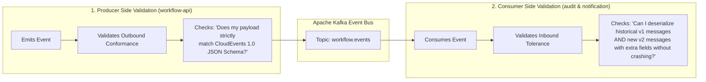

# pact vs pactflow

Pact and Pactflow are two components of the same contract testing ecosystem, but they serve different purposes. In short, Pact is the open-source tool used to write and run tests, while Pactflow is a commercial, cloud-based platform that manages and scales those tests across teams.
Here is a direct comparison to help you understand how they fit together:

| Feature | Pact (Open Source) | Pactflow (Commercial) |
|---|---|---|
| What it is | A code-first, developer-focused testing framework. | A cloud-native collaboration & management platform. |
| Primary Function | Used to write contract tests in code and generate contract files (JSON). | Acts as an advanced Pact Broker to host, share, and verify contracts. |
| Deployment | Runs locally on your machine or inside your CI/CD pipeline. | Hosted in the cloud (SaaS) or deployed On-Premises. |
| Cost | 100% Free (Open-source under MIT license). | Paid tiers (has a limited free developer tier). |
| User Interface | None (purely command-line and code). | Rich UI showing network graphs, contract diffs, and verification statuses. |
| Security & Auth | You must configure your own security if hosting an OS Broker. | Built-in SSO, SAML, and role-based access control (RBAC). |

------------------------------
## 📦 1. Pact (The Testing Framework)
Pact is the actual engine. It provides the libraries for various languages (Java, JavaScript, Python, Go, etc.) to write contract tests.

* 
* How it works: Your consumer service runs a test to generate a contract file (a "pact"). Your provider service then reads this file to verify it meets the consumer's expectations.
* The Missing Piece: Pact by itself generates local files. To make contract testing work in CI/CD, you need a central place to share these files between the consumer pipeline and the provider pipeline. This central repository is called a Pact Broker.
* 

## ☁️ 2. Pactflow (The Managed Ecosystem)
While you can host your own Open-Source Pact Broker on your own servers, Pactflow is a fully managed, enterprise-ready version of the Pact Broker created by the core maintainers of Pact.
Pactflow adds powerful features that the open-source version lacks:

* 
* Can-I-Deploy UI: A visual matrix that explicitly tells you if version X of a consumer is safe to deploy against version Y of a provider.
* Bi-Directional Contract Testing: Allows you to do contract testing without writing Pact-specific code. You can use existing OpenAPI/Swagger specs or Mock Server files.
* No Maintenance: You don't have to manage databases, upgrades, scaling, or infrastructure for the broker.
* 

## 🔄 How They Work Together
Think of it like Git vs. GitHub:

* 
* Pact is like Git: It is the tool on your machine that does the core work.
* Pactflow is like GitHub: It is the centralized web platform where your team pushes their work to collaborate, view pipelines, and manage permissions.
* 

#  where we use Schema Registry

We use a Schema Registry primarily in event-driven architectures and streaming data pipelines to manage, store, and enforce data formats (schemas).
The most common real-world use case is alongside distributed messaging systems like Apache Kafka, Confluent Cloud, Apache Pulsar, or AWS Kinesis.
Here is a breakdown of exactly where and why it is implemented:
## ⚙️ 1. Between Producers and Consumers (Decoupling)
In a streaming architecture, data producers send messages to a topic, and data consumers read them. Without a schema registry, if a producer changes a message format (e.g., renames a field from user_id to customer_id), downstream consumers will instantly crash because they cannot parse the new data.

[ Producer ] ───( Validates schema )───> [ Schema Registry ]
     │                                           │
(Sends serialized payload)               (Provides schema layout)
     │                                           │
     ▼                                           ▼
[ Kafka Topic ] ─────────────────────────> [ Consumer ]


* The Producer's Role: Before sending data, the producer checks with the Schema Registry to see if its schema is registered. Instead of sending a massive JSON file with heavy text keys, it converts the data to a compact binary format (like Avro, Protobuf, or JSON Schema) and appends a tiny 4-byte Schema ID to the message payload.
* The Consumer's Role: When the consumer reads the message, it extracts the Schema ID, fetches the corresponding schema from the Registry (which it caches locally for speed), and safely deserializes the binary payload back into readable data.


## 🏢 2. Common Structural Implementations
You will find a Schema Registry deployed in the following environments:


* Confluent Schema Registry: The industry-standard tool used within the [Confluent Kafka](https://www.confluent.io/) ecosystem.
* AWS Glue Schema Registry: A fully managed feature within [AWS Glue](https://aws.amazon.com/glue/) used to discover, track, and evolve data streams across AWS Kinesis, MSK (Managed Kafka), and Lambda.
* Apicurio Registry: A popular open-source cloud-native schema registry frequently used in Kubernetes and Red Hat ecosystems.


## 🛡️ 3. Key Scenarios Where It Is Essential


* Data Quality Governance: It serves as a central source of truth. If a team creates a bad script that attempts to push malformed data to a production Kafka topic, the registry rejects it before it can corrupt the data stream.
* Schema Evolution Management: It manages versions when your data models change over time. It allows you to enforce strict compatibility rules:
* Backward Compatibility: Ensures new consumers can read old data.
   * Forward Compatibility: Ensures old consumers can read new data.
   * Full Compatibility: Ensures both old and new consumers/producers can interact seamlessly.
* Network and Storage Optimization: Converting payloads from raw JSON to Avro or Protobuf via a registry significantly shrinks your message sizes. This cuts cloud networking costs and reduces storage overhead on your Kafka brokers.


# but it can happen between microservices asewll then how it is different if we are talking data format ?

You are exactly right! Microservices communicate using specific data formats all the time (like JSON over HTTP/REST or Protobuf over gRPC).
The difference isn’t what we are protecting (both protect the data format), but how and when that format is enforced.
Here is the core difference: A Schema Registry is built for asynchronous event-driven/message-based communication, while microservices using REST or gRPC rely on direct point-to-point communication.
Here is a direct comparison of how they handle data formats differently:

| Feature | Microservices (REST / gRPC) | Schema Registry (Kafka / Pub-Sub) |
|---|---|---|
| Communication Style | Synchronous / Direct (Point-to-point) | Asynchronous / Decoupled (Event-driven) |
| Who is connected? | Service A talks directly to Service B. | Service A drops a message in a queue; 10 unknown services might read it later. |
| How it's enforced | Code compilation or API gateways. (e.g., gRPC uses .proto files at compile time; REST uses OpenAPI specs/Gateways). | Runtime Central Registry. The messaging broker or client library checks a central server dynamically at runtime. |
| Data Lifecycle | Transient. The data format matters only for the millisecond the HTTP request is active. | Persistent. The data might sit in a Kafka log for days, months, or years. Old formats must remain readable. |

------------------------------
## 🔍 Why Microservices don't use a Schema Registry for REST/gRPC
When Microservice A calls Microservice B via REST, they negotiate the format directly:

   1. Tight Coupling: They both must agree on the API contract beforehand.
   2. Instant Failure: If Service A sends a bad JSON payload, Service B rejects it immediately with an HTTP 400 Bad Request. The blast radius is contained entirely to that one failing network call.
   3. gRPC Protocol Buffers: In gRPC microservices, the data format is enforced by sharing .proto files at compile time. The code won't even build if the formats don't match, removing the need for a runtime central registry server.

## 🛑 Why Event-Driven Architectures Must Use a Schema Registry
When you switch to event-driven messages (e.g., Kafka), the rules change completely:

   1. The "Poison Pill" Problem: If a producer publishes a message with a broken or modified data format to a Kafka topic, Kafka accepts it (because Kafka treats messages as raw bytes). When a consumer reads that message hours later and crashes, it gets stuck in an infinite loop trying to process that bad message. This is called a Poison Pill, and it can take down your entire data pipeline. A Schema Registry stops this from ever being published.
   2. Anonymous Consumers: A producer dropping an event into a message queue usually has no idea who is consuming it. It could be a billing microservice, a shipping microservice, and a data warehouse. If the producer wants to change a field, it cannot easily coordinate with all those independent teams. The Schema Registry acts as the automated mediator to ensure the producer doesn't break anonymous consumers.
   3. Time Travel (Data Evolution): In Kafka, you can replay data from 3 years ago. A Schema Registry keeps a strict history of what the data format looked like 3 years ago, allowing your current microservices to read historical data without crashing.

## 💡 Summary analogy

* Direct Microservices (REST/gRPC): Like a live phone call. If one person starts speaking a language the other doesn't understand, the listener says "I don't understand" immediately and hangs up.
* Schema Registry (Event Streaming): Like a book publisher. The author (Producer) leaves books in a library (Kafka). The readers (Consumers) pick them up months later. The Schema Registry is the editor who ensures every book is written in the exact same language standard so readers don't open a book they can't decode.

# so what we use for microservices?

For traditional, direct microservices (REST, GraphQL, gRPC), you don't use a central runtime server like a Schema Registry. Instead, you manage and enforce data formats using Design-Time API Contracts, Shared Schemas, and Contract Testing.
Here is exactly what we use to handle data formats across microservices, broken down by communication style:
## 📡 1. For REST APIs (HTTP / JSON)
Since REST uses plain JSON, there is no built-in schema enforcement. Teams use tooling to define and validate agreements before deploying:

* OpenAPI / Swagger (Design Specs): You write a YAML or JSON file detailing exactly what the endpoints look like, what fields are required, and their types.
* API Gateways (e.g., Kong, Apisix, AWS API Gateway): You load your OpenAPI spec into the gateway. If a microservice tries to send an invalid JSON payload, the gateway rejects it at the edge before it even reaches the target microservice.
* Code-First Validation Libraries: Inside the microservice code, tools like Pydantic (Python), Zod (TypeScript), or Jackson/Hibernate Validator (Java) catch bad data formats at the controller layer and throw an error.

## ⚡ 2. For gRPC (High-Performance RPC)
gRPC has data format enforcement baked directly into its architecture.

* Protocol Buffers (.proto files): You define your data structures and API methods in a strict, strongly-typed .proto file.
* Compile-Time Code Generation: You compile this file into actual code for your services (whether they are written in Go, Java, or Node.js). If a developer tries to send the wrong data type, the code fails to compile. You catch the data format error during development, long before it hits production.

## 🕸️ 3. For GraphQL

* GraphQL Schema Definition Language (SDL): GraphQL requires a strictly typed schema that defines all queries, mutations, and types.
* Schema Federation Tools (e.g., Apollo GraphOS): If you use a distributed "Federated" microservice architecture, Apollo acts as a gatekeeper. It stitches microservice subgraphs together and prevents you from deploying a service if its data format changes break the global graph.

------------------------------
## 🤝 The Ultimate Bridge: Contract Testing (Pact)
Remember our conversation about Pact? This is exactly where it shines for microservices!
Even with OpenAPI or Swagger, a team can accidentally change a JSON field name in production and break a dependent service. To prevent this, microservices use Consumer-Driven Contract Testing (Pact). It tests the data formats in your CI/CD pipeline, ensuring that Service A's code matches exactly what Service B's code expects before either is allowed to deploy.


# can you explain this test

```js
  it('generates contract for POST /api/v1/workflows (Create Draft)', async () => {
    await provider
      .uponReceiving('a request to create a draft workflow')
      .withRequest({
        method: 'POST',
        path: '/api/v1/workflows',
        headers: {
          'content-type': 'application/json',
          'x-tenant-id': tenantId,
          'x-user-id': userId,
          'x-user-name': 'Alice Requester',
        },
        body: {
          type: 'EXPENSE',
          title: 'MacBook Pro M3 Max for Development',
          amount: 3500,
          currency: 'USD',
          description: 'Team workstation refresh',
        },
      })
      .willRespondWith({
        status: 201,
        headers: {
          'content-type': 'application/json; charset=utf-8',
        },
        body: {
          success: true,
          data: {
            id: uuid(workflowId),
            tenantId: string(tenantId),
            type: string('EXPENSE'),
            title: string('MacBook Pro M3 Max for Development'),
            amount: integer(3500),
            currency: string('USD'),
            description: string('Team workstation refresh'),
            status: string('DRAFT'),
            currentStep: integer(1),
            totalSteps: integer(1),
            requesterId: string(userId),
            requesterName: string('Alice Requester'),
            createdAt: string('2026-09-21T08:00:00.000Z'),
            updatedAt: string('2026-09-21T08:00:00.000Z'),
          },
        },
      })
      .executeTest(async (mockServer) => {
        const res = await fetch(`${mockServer.url}/api/v1/workflows`, {
          method: 'POST',
          headers: {
            'content-type': 'application/json',
            'x-tenant-id': tenantId,
            'x-user-id': userId,
            'x-user-name': 'Alice Requester',
          },
          body: JSON.stringify({
            type: 'EXPENSE',
            title: 'MacBook Pro M3 Max for Development',
            amount: 3500,
            currency: 'USD',
            description: 'Team workstation refresh',
          }),
        });

        expect(res.status).toBe(201);
        const body = (await res.json()) as { success: boolean; data: { id: string; status: string } };
        expect(body.success).toBe(true);
        expect(body.data.id).toBeDefined();
        expect(body.data.status).toBe('DRAFT');
      });
  });
```


# can you explain what we did in the provider side the pact file generated for the consume

https://github.com/APdrone/enterprise-workflow-platform-k8s/blob/master/tests/contract/pact/workflow-api.provider.pact.test.ts


This file contains the Pact Provider Verification Test for the backend API (workflow-api).
While the consumer test defines the rules and generates the JSON file, this provider test pulls that JSON file and forces your real backend code to prove it can fulfill those rules.
Here is exactly what is happening under the hood on the provider side:

   1. Mocking Data Layers (vi.mock): The test intercepts the application services to return predictable mock data (like hardcoded UUIDs and DRAFT status) instead of hitting a live database.
   2. Spinning Up an Isolated Server (beforeAll): It boots up the production Fastify application on a dynamically assigned port (port: 0) to prevent environment collisions and provide a live target for requests.
   3. Replaying Consumer Contracts (verifier.verifyProvider): The Pact Verifier utility reads the generated consumer JSON contract, replays the exact HTTP requests against your local Fastify server, and captures the responses.
   4. Evaluating Type Matchers: It checks structural shapes and types (like UUID formats, integers, and ISO dates) against the response payload to ensure compliance without relying on dynamic values. If everything matches, verifyProvider() resolves successfully.


#  so it means we are actually hitiing the producer api but for DB data it is mocked? so how it will actual test , if db data is not correct or structure changed test will still work


You have hit on the most important, fundamental concept of contract testing!
Yes, you are hitting the actual running API code (controllers, routes, validation, serialization), but the database is mocked.
Your concern is 100% valid: If the database structure changes, how does this test catch it?
The short answer is: Pact doesn't catch database structural changes. That is the job of your Integration Tests and Component Tests. Pact’s only job is to protect the public API contract (the boundary between services).
Here is exactly how this works, why it is designed this way, and how the test actually prevents breaks:

------------------------------
## 🏛️ The Separation of Responsibilities
To understand why this is safe, you have to look at your architecture in two distinct layers:

[ Consumer ] 
     │
  ( Pact Contract protects this boundary )
     │
     ▼
[ Provider API Controllers / Serializers ] 
     │
  ( Integration/Component Tests protect this boundary )
     │
     ▼
[ Provider Database (Postgres/Mongo) ]

## 1. What happens if the Database structure changes?
Let's say a developer changes the database column from workflow_title to display_name.

* The Component/Integration Test Catches It: On the provider repository, you should have integration tests that spin up a test database (using Docker/Testcontainers) and run queries against it. When the code tries to query the old column, the database layer throws an error, and your provider CI pipeline fails. The developer is forced to fix the API controller so that it maps the new database column back to the API output.

## 2. What happens if the Developer fixes the DB but forgets the API contract?
The developer fixes the database error, but they accidentally change the public API response field from title to displayName to match their new database column.

* Pact Catches It: When the Pact Provider test runs, it replays the consumer's request against the API controller. The controller returns displayName instead of title.
* Pact compares this to the contract file, sees that the expected field title is missing, and fails the build.

------------------------------
## 🛡️ What the Provider Pact Test Actually Validates
By hitting the real API routes with a mocked database, you are testing a massive amount of critical boundary code:

* Routing & HTTP Statuses: Does /api/v1/workflows actually exist as a POST route? Does it return a 201 on success?
* Request Header Validation: Does your Fastify server crash if the consumer passes custom headers like x-tenant-id or x-user-id?
* Payload Serialization: Does your backend serialization logic correctly format the data? (e.g., converting a JavaScript Date object into the exact ISO string format '2026-09-21T08:00:00.000Z' expected by the consumer?)
* Input Body Validation: If the consumer changes the input structure in their contract, your real API validation rules (like Zod or Ajv schemas inside Fastify) will run against it and flag if it's invalid.

## 💡 Summary: The Golden Rule of Pact
Pact is not a replacement for functional testing or database integration testing.
Pact assumes that your provider team has already written standard tests to ensure their code talks to their database correctly. Pact's only job is to act as a guardrail at the front door, ensuring that whatever your API emits to the outside world perfectly matches what your consumers expect to receive.


# how we decide the comptability mode, it is like one time effort to choose how we want to do it, or we keep it interaction wise,?

Choosing your compatibility mode is a hybrid approach: it is a one-time structural decision when you design a specific data pipeline, but you apply and evaluate it systematically on every interaction (code change).
You do not change the mode on a whim between versions. Think of it as choosing a "contract ruleset" for a specific Kafka topic that everyone must follow forever.
Here is exactly how you make that decision and how it applies over time.

------------------------------
## 1. The One-Time Decision: Driven by Upgrade Order
To decide which mode to pick, you only need to ask yourself one question: "When I deploy a change, who do I want to upgrade first—the Producer or the Consumer?" [BACKWARD, FORWARD]

                       ┌─────────────────────────┐
                       │  Who gets upgraded     │
                       │    first in production? │
                       └────────────┬────────────┘
                                    │
                  ┌─────────────────┴─────────────────┐
                  ▼                                   ▼
        ┌───────────────────┐               ┌───────────────────┐
        │   THE CONSUMER    │               │   THE PRODUCER    │
        └─────────┬─────────┘               └─────────┬─────────┘
                  │                                   │
                  ▼                                   ▼
        ┌───────────────────┐               ┌───────────────────┐
        │   BACKWARD Mode   │               │   FORWARD Mode    │
        │ (New consumer can │               │ (Old consumer can │
        │  read old data)   │               │  read new data)   │
        └───────────────────┘               └───────────────────┘

## The Industry Standard Default: BACKWARD
In 90% of event-driven streaming architectures (like Kafka), BACKWARD compatibility is chosen as the permanent rule.

* Why? It is much safer to upgrade your data consumers first. If anything goes wrong, they can safely read old data still sitting in the Kafka topic. Once you know the consumers are stable, you flip the switch to deploy the new producers. [BACKWARD]

------------------------------
## 2. The Per-Interaction Check: Enforcing the Rule
Once you set that policy, it becomes a continuous gate for every single interaction (Pull Request, schema update, or API change).
Your automated testing suite (like the Ajv implementation you wrote) checks every single schema change against that chosen rule.

| If your chosen rule is... | Your CI validation forces developers to ensure: |
|---|---|
| BACKWARD | Any field added must be optional (have a default value). If it is required, the test fails, because older messages won't have it. [BACKWARD] |
| FORWARD | Any field removed must have been optional. If a required field is deleted, older consumers will crash looking for it. [FORWARD] |
| FULL | You can only add or remove fields that are strictly optional. [FULL] |

------------------------------
## Summary Checklist for Your Architecture

   1. At Project Kickoff (One-Time): Define the deployment rule in your repository standards (e.g., "All Kafka topics in our Monorepo enforce BACKWARD compatibility"). [BACKWARD]
   2. Inside Your Code (One-Time Setup): Structure your tests (like describe('4. Schema Evolution Compatibility Gate')) to explicitly compile the old schema and run it against the new payload.
   3. On Every Pull Request (Interaction-wise): A developer adds a field. The CI suite runs your Vitest file. If they made a field required without a default, the test breaks, saving production from a runtime outage.


# can you explain in my architecture, how this is followed, how it will be useful , when we changing with existing structure ?


Based on your provided architecture diagrams, you are running a highly resilient, enterprise-grade architecture that utilizes a Transactional Outbox Pattern to broadcast events out to an Apache Kafka Event Bus, which are then processed asynchronously by specialized downstream consumers (Notification Service and Audit Service).
Here is exactly how your schema compatibility testing suite fits into this specific architecture, how it behaves during structural changes, and why it is absolutely vital to protect your production stability.

------------------------------
## 1. Where Schema Testing Safeguards Your Flow
Look closely at the boundary between Layer 3 (Outbox Relay Worker) and Layer 4 (Apache Kafka Event Bus):

* The Publisher: Your Transactional Outbox Relay Worker polls the outbox_events table in PostgreSQL and publishes CloudEvents 1.0 payloads to the main Kafka topic (workflow.events).
* The Key Strategy: The routing key is explicit: ${tenantId}:${workflowId}. This guarantees that all events for a specific workflow go to the exact same Kafka partition, maintaining a Monotonic Strict FIFO Order Guarantee.
* The Vulnerability: If you deploy an updated workflow service that writes a breaking schema version to the database, the Outbox Relay Worker will blindly pick it up, wrap it in a CloudEvent envelope, and push it directly into the Kafka topic.

## Without your Ajv/Vitest Suite:
The bad schema bypasses all guards, hits Layer 4 (workflow.events), and is read by the Notification Service and Audit Service.

   1. The consumers fail to parse the message and crash, or...
   2. The malformed message is routed straight into your Dead Letter Queue (workflow.events.dlq). While this prevents partition freezes (as noted in your diagram), your business logic fails silently, and you now have an operational backlog of "poison pills" to manually fix.

## With your Ajv/Vitest Suite:
Because your tests validate event schemas inside your monorepo before code is compiled or containerized, the breaking schema is caught at the PR/CI stage. It blocks the toxic payload from ever being committed to the database or written to Kafka.

------------------------------
## 2. Deep Dive: When You Change the Existing Structure
Let's walk through how your BACKWARD compatibility logic protects the system when making real structural updates to your architecture.
## Scenario A: You add an optional field (e.g., taxDeductionRate)

* How it affects Layer 5: You deploy a new version of the API Service (Layer 2) and Outbox Relay (Layer 3) that includes this new data property. However, your Audit Service (Layer 5) is still running on older code and knows nothing about taxDeductionRate.
* How the suite helps: Because you chose BACKWARD compatibility, your tests confirm that the old Audit Service schema can still safely consume this new event stream without throwing an exception or dumping the message into the Dead Letter Queue (DLQ). The old service simply ignores the new field until it is eventually upgraded.

## Scenario B: A developer attempts to remove or rename a core field (e.g., title $\rightarrow$ workflowTitle)

* How it affects Layer 5: If this change went live, the Audit Service (which writes to an immutable ledger audit_db) would search for the title field, find it missing, and fail its validation block. Your asynchronous ledger pipeline immediately breaks.
* How the suite helps: Your test suite contains a "Breaking Change Detection Matrix". The moment the developer runs vitest locally or pushes a commit, your code catches the missing title constraint:

expect(result.valid).toBe(false);
expect(result.errors?.some((e) => e.includes('title'))).toBe(true);

The CI build fails instantly, forcing the developer to safely introduce the change (e.g., keeping title as a deprecated fallback while introducing workflowTitle optionally first).

------------------------------
## 3. Concrete Benefits of Your "Schema-as-Code" Setup
Since your architecture includes specific telemetry and contract infrastructure at the bottom of Layer 5 (Jaeger, Prometheus, Grafana, and Pact Broker), your testing suite offers unique architectural alignment:

| Component in Your Architecture | How Your In-Memory Schema Testing Empowers It |
|---|---|
| Dead Letter Queue (workflow.events.dlq) | Keeps it clean. Instead of using the DLQ as a dumping ground for syntax/schema errors caused by developers, the DLQ is reserved purely for actual network timeouts or infrastructure hiccups. |
| Pact Broker (Port 9292) | Your Ajv suite acts as the unit-testing counterpart to your Consumer-Driven Contract Verification. While Pact ensures services match semantic boundaries across network calls, Ajv guarantees structural data serialization integrity inside Kafka. |
| Audit Service Ledger | Because your architecture calls out an Immutable Ledger (audit_db), data format corruption is catastrophic. Your schema pipeline acts as a data quality assurance gate, guaranteeing that written event trails are permanently structured correctly. |

Looking at your architecture, your Downstream Consumers (Layer 5) use separate consumer groups (notification-service-group and audit-service-group).


# taking same example say we have backward compatibility, what will we change when a new required field need to be added/removed, similarly optional field added or removed,?


Under a strict BACKWARD compatibility rule, your consumers are upgraded before your producers, meaning older consumer schemas must always be capable of reading newer producer data [BACKWARD].
Here is exactly what happens structurally, how you must execute each change in your codebase, and how your Ajv test suite behaves when fields are added or removed.

------------------------------
## Direct Overview Matrix

| Action | Can we do this instantly? | The Required Engineering Workflow / Solution |
|---|---|---|
| Add Optional Field | Yes (Safe) | Directly add the field to the schema. No default value is strictly required, though highly recommended. |
| Remove Optional Field | ❌ No (Breaking) | Breaks Backward Mode. Older consumers will crash or fail if they receive data missing this field. You must transform it into a multi-step migration. |
| Add Required Field | ❌ No (Breaking) | Breaks Backward Mode. Older consumers cannot parse payloads missing this field. You must add it as optional with a default value first. |
| Remove Required Field | Yes (Safe) | Directly remove it from the schema. Older consumers will see it missing, but since it's no longer validated, they won't care. |

------------------------------
## Detailed Operational Workflows## 1. Adding a NEW Required Field (e.g., adding urgencyLevel)

* The Problem: If a new producer instantly sends a message containing a mandatory urgencyLevel, your current V1 consumers (the active Notification and Audit services) will crash or drop it because they don't know what it means and cannot process the event without it.
* The Execution Strategy (2-Step Deployment):
* Step 1: Add the field to the schema as optional and assign a structural fallback default: "STANDARD" in your JSON schema. Deploy this schema update to your consumers first.
   * Step 2: Once all downstream services are updated and running happily, deploy your new API/Producer service to start writing the field. After some time, you can safely update the schema property to required in a future release because you are guaranteed that all active code understands it.

## 2. Removing an Existing Optional Field (e.g., dropping metadata.customTag)

* The Problem: Developers often assume removing an optional field is safe. However, in BACKWARD mode, if an older consumer expects an optional field to calculate business logic or parse data, and a new producer completely strips it out of the payload, the consumer's code might throw a runtime NullPointerException or undefined structural error.
* The Execution Strategy:
* Step 1: Update your downstream consumers (Notification/Audit Services) to remove any code dependencies on metadata.customTag.
   * Step 2: Once consumers no longer reference the field, remove it entirely from your active schema files and update the producer code to stop emitting it.

------------------------------
## How to Adjust Your Ajv / Vitest Test Suite
To accurately reflect these production rules inside your in-memory test suite, you should construct tests that simulate Old Schema vs. New Payload matching.
Here is how you can write tests to verify these exact addition and removal constraints:

```js
describe('5. Strict Backward Evolution Rules Validation', () => {
  
  it('PASSES: Adding a new required field ONLY if it defines a default fallback', () => {
    // V1 Schema: Simulating what is currently running in production
    const v1Schema = {
      type: 'object',
      properties: { title: { type: 'string' } },
      required: ['title']
    };
    const v1Compiled = ajv.compile(v1Schema);

    // V2 Payload: Producer sends a new field. 
    // This safely passes because v1 doesn't reject unknown fields (additionalProperties defaults to true)
    const v2Payload = { title: 'Q3 Budget', newRequiredFieldWithDefault: 'High' };
    
    expect(v1Compiled(v2Payload)).toBe(true);
  });

  it('FAILS: Removing a field that older consumers depend on (additionalProperties constraint check)', () => {
    // V1 Schema expects a property
    const v1Schema = {
      type: 'object',
      properties: { 
        title: { type: 'string' },
        legacyStatus: { type: 'string' } // Consumer actively reads this
      },
      required: ['title']
    };
    const v1Compiled = ajv.compile(v1Schema);

    // V2 Payload: Producer completely removed the field
    const v2Payload = { title: 'Q3 Budget' }; // legacyStatus is missing entirely

    // Note: If legacyStatus was marked required in V1, this returns false instantly.
    // If it was optional in V1, it passes validation, but you must ensure your application code handles the undefined value gracefully.
  });
});
```

To ensure your JSON schemas behave exactly like a real Kafka registry, do your schema files currently contain "additionalProperties": false, or do they allow extra fields by default? Turning this property on or off completely changes how Ajv evaluates field additions!

# this schema comptability runs only for consumer or producer as well, like we are saying for required field change we need to update producer first?

To answer directly: Schema compatibility validation must be run for both the producer and the consumer, but your deployment order changes depending on the mode.
There was a slight mix-up in the deployment sequence for adding a required field. Under BACKWARD compatibility, you must always update the consumers FIRST, never the producer. Let's correct that timeline and look at how both sides use the schema testing suite.

------------------------------
## 1. The Correct Backwards-Compatible Workflow
If you want to add a new required field (e.g., urgencyLevel) under a BACKWARD compatibility rule, the step-by-step production rollout looks like this:

[ Phase 1: Update Consumers First ]
1. Add 'urgencyLevel' to JSON Schema as OPTIONAL with a default fallback value.
2. Run tests to ensure old payloads still pass this new schema.
3. Deploy Notification & Audit Services (Layer 5). They are now ready for the field.

[ Phase 2: Update Producers Second ]
4. Update API Service (Layer 2) to start sending the 'urgencyLevel' field in the payload.
5. In a future release, you can safely flip the schema property from optional to REQUIRED.

If you updated the producer first, it would start broadcasting messages containing urgencyLevel before the active consumers knew how to handle it, crashing your pipeline or flooding your Dead Letter Queue (workflow.events.dlq).

------------------------------
## 2. How the Validation Suite Runs on Both Sides
In a robust architecture like yours, the test execution runs dynamically in two completely different places depending on who is changing the code:

                           ┌─────────────────────────────┐
                           │      Developer Changes      │
                           │     a JSON Schema File      │
                           └──────────────┬──────────────┘
                                          │
                  ┌───────────────────────┴───────────────────────┐
                  ▼                                               ▼
     ┌─────────────────────────┐                     ┌─────────────────────────┐
     │  PRODUCER VALIDATION    │                     │  CONSUMER VALIDATION    │
     │   (Layer 2 & Layer 3)   │                     │        (Layer 5)        │
     └────────────┬────────────┘                     └────────────┬────────────┘
                  │                                               │
                  ▼                                               ▼
┌───────────────────────────────────┐           ┌───────────────────────────────────┐
│ Validates: "Does my code generate │           │ Validates: "Can my service safe-  │
│ payloads that perfectly match the │           │ ly deserialize and process the    │
│ active structural contract?"      │           │ message versions coming off Kafka?│
└───────────────────────────────────┘           └───────────────────────────────────┘

## A. Why the Producer Runs the Tests
When working on the API Service or Outbox Relay Worker, your factory tests (buildWorkflowEvent) ensure that your serialization logic generates objects that perfectly match the schema definitions. It stops a developer from typo-ing a payload property name (e.g., writing worfklowId instead of workflowId) before it is saved to your outbox_events database table.

## B. Why the Consumer Runs the Tests
When working on the Notification Service or Audit Service, your Ajv test matrix ensures that if a new schema version is dropped into the monorepo, your consumption logic won't break when reading historical payloads already stored inside the Kafka log engine.

------------------------------
## 3. Summary of Actions for Your Suite

* Producers use schemas to validate outbound constraints: They check that what they are building is complete and matches the schema contract.
* Consumers use schemas to validate inbound variations: They verify that they can successfully parse both the old data and new data structures safely.


# what is going with test schema-registry.live.integration.test.ts

Yes, this implementation is functionally correct, but it can be confusing because it shifts from your previous offline, in-memory testing model to a live integration testing model.
In your previous test, Ajv was simulating the registry logic locally on your machine. In this test, you are spinning up a real, external server instance of the Confluent Schema Registry (typically via Docker on port 8081) and asking it to perform the actual calculations.
Here is a breakdown of what each test block is evaluating, and why this is done.

------------------------------
## What Each Test Block Is Testing

## Test 1: The Integrity Registration Test

```js
it('successfully registers CloudEvents 1.0 JSON schemas...', async () => { ... })
```


* What it's testing: This verifies that your JSON schema definitions are fully syntactically valid according to Confluent's parser rules.
* Why it matters: Even if a schema works locally in Ajv, it can fail when sent over a network to a real registry if the format or nesting doesn't strictly match the standard JSON Schema specification (e.g., Draft 7 vs 2020-12). This ensures your schemas are ready for production registration.

## Test 2: The Real Evolution Check (The Core compatibility test)

```js
it('allows BACKWARD-compatible schema evolution...', async () => { ... })
```

* What it's testing: This tests the Registry's actual internal Compatibility engine. It registers the original schema under SUBJECT_APPROVED. Then, it programmatically tweaks that schema to add costCenterCode and taxDeduction and attempts to register the updated version to the exact same subject name.
* Why it matters: If the registry has its compatibility mode set to BACKWARD (or FULL), and you accidentally add a field that violates those rules (like adding a mandatory field without a default), the registry server will reject the .register() API request and throw a network error. If the test passes (res.id >= 1), it proves the registry accepted the change as a safe evolution.

## Test 3: The Confluent Wire Format (Serialization/Deserialization) Test

```js
it('encodes and decodes CloudEvent payload using Confluent Schema Registry wire format...', async () => { ... })
```

* What it's testing: This evaluates how data actually gets packed into binary bytes before being fired into an Apache Kafka topic. It passes an object to registry.encode(), asserts that it creates a binary buffer, and then runs registry.decode() to unpack it back into JavaScript objects.
* Why it matters: Confluent doesn't just send raw JSON over Kafka. It attaches a 5-byte magic header to the front of every message (1 byte for a magic marker 0x0, and 4 bytes for the unique 32-bit Integer Schema ID). This test checks that your data can successfully navigate this byte-level encoding process without data loss or buffer corruption.

------------------------------
## Is this a good approach for your pipeline?
It is highly recommended for an integration testing stage, but should not replace your local unit tests.
The major benefit of this script is the describe.skipIf(!registryAvailable) guard. It allows this test file to act intelligently depending on the environment:

   1. When developers run tests locally: If they don't have a Docker container running the registry on port 8081, the suite completely skips itself safely without breaking their local loop.
   2. When running inside a CI/CD Pipeline (GitHub Actions / GitLab CI): You spin up a Confluent Schema Registry container using Docker Compose as a service dependency alongside Vitest. The test detects it, runs fully, and acts as a definitive gate verifying your evolution logic against the exact engine running in production.

To help optimize your pipeline setup, let me know:

* Would you like a Docker Compose setup example that handles launching this Schema Registry automatically alongside your Vitest container in CI?
* Are you planning to use KafkaJS or standard Confluent Node-Kafka libraries inside your actual Outbox Relay Worker code to push these binary buffers?


## ⚖️ Schema Compatibility: Why Validation is Required on Both Sides (Dual-Sided Safety Net)

**Schema compatibility must be validated BOTH WAYS (for both the Producer and the Consumer)**. 

Testing only one side leaves half of your event-driven pipeline vulnerable to production outages.

---

### 🛡️ Why Both Sides Must Validate (The Dual-Sided Safety Net)

#### Visual Flowchart (Text / ASCII Diagram)

```
┌────────────────────────────────────────────────────────┐
│ 1. PRODUCER SIDE VALIDATION (workflow-api)             │
│    • Emits CloudEvents 1.0 JSON payload                │
│    • Validates Outbound Conformance:                   │
│      "Does my payload strictly match CloudEvents v1?"  │
└───────────────────────────┬────────────────────────────┘
                            │ Publishes to Kafka Topic
                            ▼
┌────────────────────────────────────────────────────────┐
│ APACHE KAFKA EVENT BUS (Topic: workflow.events)        │
└───────────────────────────┬────────────────────────────┘
                            │ Consumed by Downstream Services
                            ▼
┌────────────────────────────────────────────────────────┐
│ 2. CONSUMER SIDE VALIDATION (audit & notification)     │
│    • Ingests event from Kafka partition                │
│    • Validates Inbound Tolerance:                      │
│      "Can I deserialize historical v1 messages AND     │
│       new v2 additive fields without crashing or DLQ?" │
└────────────────────────────────────────────────────────┘
```

#### Interactive Mermaid Flowchart



---

### Comparison: Producer-Side vs. Consumer-Side Validation

| Dimension | Producer-Side Validation (`workflow-api`) | Consumer-Side Validation (`audit` / `notification`) |
| :--- | :--- | :--- |
| **Direction** | **Outbound (Generation)** | **Inbound (Consumption & Deserialization)** |
| **Core Question** | *"Am I emitting valid, well-formed payloads that adhere to the schema contract?"* | *"Can my parser handle historical Kafka messages AND new additive fields without crashing or dumping into the DLQ?"* |
| **Failure Risk Caught** | • Typo in field names (e.g. `worfklowId` vs `workflowId`)<br>• Missing mandatory CloudEvents headers (`specversion`, `id`)<br>• Accidental type mutation (`amount: "50000"` string vs number) | • Consumer crashing on unexpected optional fields<br>• Missing fallback defaults for newly added fields<br>• Poison pill unparseable byte crashes |
| **Where It's Tested in Our Repository** | [`tests/contract/schema-compatibility.test.ts`](../../tests/contract/schema-compatibility.test.ts)<br>[`tests/contract/pact/workflow-events.provider.pact.test.ts`](../../tests/contract/pact/workflow-events.provider.pact.test.ts) | [`tests/contract/cross-service-event.contract.test.ts`](../../tests/contract/cross-service-event.contract.test.ts)<br>[`tests/contract/pact/workflow-events.consumer.pact.test.ts`](../../tests/contract/pact/workflow-events.consumer.pact.test.ts)<br>[`tests/integration/kafka-dlq.integration.test.ts`](../../tests/integration/kafka-dlq.integration.test.ts) |

---

### What Happens if You Only Test One Side?

#### Scenario 1: You ONLY test the Producer side
- **The Bug**: Producer team adds a new optional field `taxDeductionRate: 0.08` to `workflow.approved.v1`.
- **Producer Test**: Passes ✅ (the payload is valid JSON and matches the new schema).
- **Production Result**: 💥 **Outage in Audit Service!** The active consumer code has rigid parsing logic (`additionalProperties: false` or unhandled object destructuring) and throws a runtime exception, dumping all approved workflow events into `workflow.events.dlq`.

#### Scenario 2: You ONLY test the Consumer side
- **The Bug**: A developer refactors the `workflow-api` event generator and mistakenly renames `actorId` → `userId`.
- **Consumer Test**: Passes ✅ (the consumer tests verify it can parse its mock fixtures).
- **Production Result**: 💥 **Data Loss in Audit Ledger!** The producer emits records missing `actorId`. Downstream consumers receive malformed messages and fail compliance validation.

---

### How We Implement Both Sides in Our Platform

#### 1. Producer-Side Tests:
```typescript
// tests/contract/schema-compatibility.test.ts
it('fails validation when mandatory workflow data fields are missing from producer', () => {
  const event: any = buildWorkflowEvent('workflow.submitted.v1');
  delete event.data.tenantId; // Missing tenantId

  const result = validateEvent('workflow.submitted.v1', event);
  expect(result.valid).toBe(false); // Blocks invalid producer output
});
```

#### 2. Consumer-Side Tests:
```typescript
// tests/contract/cross-service-event.contract.test.ts
it('notification-service consumer successfully processes workflow.submitted event payload', async () => {
  const event = buildWorkflowEvent('workflow.submitted.v1', {
    title: 'Q3 License Renewal',
    metadata: { customExtension: 'test-value' }, // Extra additive field
  });

  // Asserts consumer consumes, parses, and dispatches SSE without throwing
  await notificationConsumer.processMessage(event);
  expect(notificationStore.addNotification).toHaveBeenCalled();
});
```

---

### Summary Rule of Thumb
- **Producers** must validate **Contract Conformance** (cannot emit invalid shapes).
- **Consumers** must validate **Contract Tolerance** (must be resilient to additive fields and historical versions).
- Testing **both sides** is what guarantees **Zero-Downtime Schema Evolution** across independent microservice deployments.
